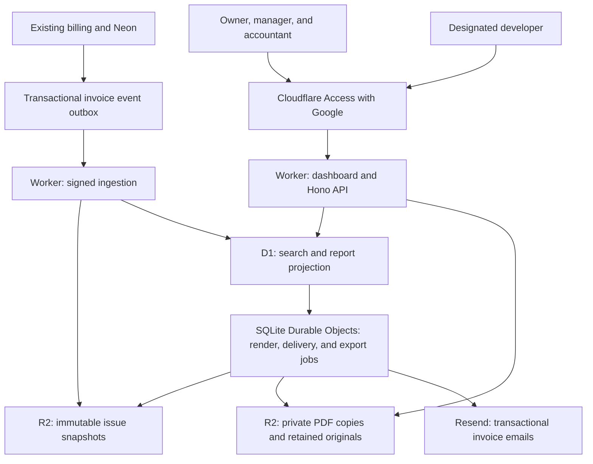

# Cloudflare invoice application plan

Status: final implementation plan, updated 2026-11-26. Production rollout depends on the runtime, data, access, and accounting checks below.

## Build decision

Build one Cloudflare invoice application in `apps/invoice`. Use Cloudflare Access for Google sign-in, a React/Vite dashboard and Hono API on Workers, D1 for branch-scoped operations and reporting, SQLite Durable Objects for costly and retryable work, and private R2 for PDFs and evidence. Existing checkout and financial issuance stay in Neon. Once Cloudflare has received an issued invoice, routine portal work can use its Cloudflare copy without calling AWS.

Deliver in three increments. First prove the Cloudflare Free runtime and release the core invoice portal after its access, backup, and delivery checks pass. Then add daily finance workflows and the monthly accountant close. Complete the remaining expense, settlement, and long-term retention work in the final increment. Include WACRM as a later delivery channel with its own implementation and billing verification.

## Confirmed requirements

- Host at `invoice.theroyalglow.in` on Cloudflare Workers, targeting free allowances for 30-50 invoices/day.
- Store private invoice files in the existing `rgss-invoices` R2 bucket.
- Use pdfcn Takumi components and `takumi-pdf`.
- Automatically email the service invoice as a PDF attachment through Resend once the service is complete and payment is recorded. Keep Brevo for the marketing and follow-up flows defined in the existing email strategy.
- Expire regenerable PDF copies **180 days after generation**. A newly regenerated copy gets another 180 days; reading or emailing an existing copy does not extend its lifetime.
- Look up old invoices by booking ID, regenerate, download, and explicitly resend the customer email on request.
- Add WhatsApp Business PDF attachments in a later WACRM phase using the same issued invoice and PDF.
- Use **Google Sign-In only**. Admit exact Gmail addresses assigned by an owner or the designated developer. Owners, managers, and accountants use the invoice portal. The developer has a separate access-management permission.
- Enforce **multi-branch access** on every invoice and report operation. Accountants (CAs) have read-only access to records and exports for assigned branches.
- Add a payment ledger for split tenders and deposits, daily branch close and payment reconciliation, refunds and corrections, monthly close by GSTIN, inter-branch settlement visibility, and supplier bills and expenses.
- Keep the Cloudflare portal and portable Node renderer under the single `apps/invoice` workspace (`@rgss/invoice`).
- Preserve a portable rendering core and Node container recovery path for Render/Railway.
- Include branch invoice readiness, a billing exceptions queue, and an export verified against the accountant's workflow. Add business buyer documents and deposit or deferred-payment capabilities as applicable to actual branch needs and CA-reviewed document rules.
- Demonstrate Free-plan feasibility with a synthetic deployment before adopting the design in production.

## Current baseline

The existing Hono/Node service uses React PDF, verifies raw-body HMAC before parsing, validates shared contracts, and conditionally creates/reuses R2 objects. Private storage and signed downloads already exist alongside legacy public URL support. Preserve these protections and compatibility.

The admin job loads an issued invoice, calls the renderer, and sends email through Resend. Some failures fall back to email without a PDF. The new workflow must expose failures and retain retryable work.

Neon currently owns invoice issuance, numbering, booking/payment relationships, and financial calculations. Its schema already contains branch, financial year, issuer snapshots, tax review status, and line-level tax facts. However, `getInvoiceForPdf` reads the current customer profile and falls back to current branch details for legacy invoices. This is insufficient for faithful regeneration after data changes.

Membership purchases can lack a booking ID, so invoice number/ID lookup is also required. Authorized customer search can help locate these records.

The checkout includes an invoicing Vitest project and a Node container with a CI health check. Historical deployment definitions target Cloud Run. Cloudflare runtime and production cutover remain to be verified.

### Knowledge base findings applied to this plan

| Reference | What to carry into the Cloudflare app |
| --- | --- |
| [Billing design](billing-invoice-flow.md) and [admin billing pages](../knowledge-base/pages/admin.md) | Reuse the invoice register, detail view, PDF preview, payment information, and export date presets. The implemented `/billing` APIs already require a receptionist or higher for the active branch. Add booking ID lookup and invoice-specific delivery history in the portal. |
| [Background jobs](../knowledge-base/background-jobs.md) | Preserve prompt dispatch after paid checkout. The current service checkout enqueues the signed QStash invoice job after committing the billing transaction. A historical section describes in-request email. Keep checkout responsive through a durable outbox and immediate asynchronous dispatch. |
| [Authentication and branch roles](../knowledge-base/authentication.md) | Carry over Google-only sign-in and the existing owner/manager branch relationships. The invoice portal limits access to its eligible roles and exact Gmail grants. It adds an accountant role scoped to approved branches. |
| [Email strategy](../knowledge-base/email-strategy.md) | Use Resend for transactional invoices and Brevo for marketing. The older spec lists automatic email for all three invoice types. The current membership purchase and session completion routes create invoice records without enqueuing the service invoice PDF job. |
| [Deployment](../knowledge-base/deployment.md) and [migration discipline](../.kiro/steering/migration-discipline.md) | Keep the signed renderer contract and private R2 keys during migration. Use forward Drizzle migrations for Neon and separate Wrangler migrations for D1. |

### Invoice types and initial delivery rules

| Type | Source transaction | Cloudflare behavior |
| --- | --- | --- |
| `service` | Service checkout completes the booking and records the paid invoice. | Automatically email the PDF through Resend once both facts are present. Include it in sales and tax reports using its recorded amounts. |
| `membership_purchase` | Purchase creates a paid invoice for the selling branch, with no booking ID. | Index and render by invoice ID or number. Include the sale using the recorded issuer and tax facts. Confirm automatic email before enabling it as a change from the current route. |
| `membership_session` | The delivering branch records the completed session and a zero-value invoice covered by the membership. | Show it separately in the register and provide PDF retrieval. Keep financial sales and GST totals based on the paid purchase and service invoices. Confirm whether to send session PDFs automatically as a separate customer communication decision. |

All three issue paths use `issueInvoiceStatements`. Use this shared persistence boundary for consistent snapshot and outbox coverage, while keeping the surrounding checkout, purchase, and session transactions intact. [Service checkout query](../packages/db/src/queries/admin-bookings.ts) and [membership queries](../packages/db/src/queries/memberships.ts).

## Cloudflare architecture

| Component | Responsibility |
| --- | --- |
| Workers static assets | React/Vite dashboard using repository UI conventions. |
| Hono Worker API | Authentication, branch/role authorization, bounded signed ingestion, search, jobs, and protected downloads. |
| SQLite Durable Objects | Execute Takumi, delivery, CSV imports, and larger exports outside the gateway. Coordinate work per invoice or import/export job and wake pending work with alarms. |
| D1 | Indexed projections of invoices, payments, refunds, and inter-branch settlements. Owns portal grants, reconciliation, close records, supplier bills and expenses captured here, and delivery and audit metadata. |
| R2 Standard | Complete issue snapshots, PDF copies, retained originals, protected exports and payment attachments in separate prefixes. |
| Cloudflare Access | Google-only authentication with an exact Gmail allowlist for this portal. D1 grants control branch and action access. Verify account eligibility and seat allowance. |
| Resend adapter | Send the initial invoice and owner/manager email resends through the existing transactional provider. |

The invoice portal, rendering, storage, and reporting run on Cloudflare. Existing billing issues invoices in Neon, and Resend delivers customer invoice emails. Brevo continues to handle campaigns, promotional follow-ups, and associated marketing contact flows. [Existing email strategy](../knowledge-base/email-strategy.md).

### Application surfaces and Cloudflare configuration

| Surface | Planned behavior and data source |
| --- | --- |
| `/` | Dashboard with branch and period selectors, sales and collections, output GST, and data freshness from D1. |
| `/invoices` and `/invoices/:id` | Search the D1 register, inspect issued facts, payment allocations, linked adjustments, and delivery history. Stream an authorized R2 file or queue regeneration. Resend requires a separate owner or manager action. |
| `/reports` | View GST and collections reports and request CSV exports. Use bounded requests for previews and durable jobs for large exports. |
| `/reconciliation` | Close the branch cash drawer by IST business date, import bank or provider statements, and resolve unmatched payments and deposits. |
| `/refunds` | Request a refund or correction against the original invoice and track approval and execution. |
| `/monthly-close` | Prepare a close package by GSTIN and period with exceptions, CA exports, payment evidence, and filing acknowledgments. |
| `/settlements` | View existing membership and gems settlement activity with role-specific financial visibility. |
| `/expenses` | Record or import supplier bills and expenses, attach evidence, and export the purchase register for the CA. |
| `/tax-payments` | View payment evidence by GSTIN and period. Owners record challans and payment details for their branches. |
| `/operations` | Owners and managers inspect invoice readiness, the billing exceptions queue, and failed and pending work for their branches. |
| `/access` | An owner or the designated developer adds, changes, and revokes exact Gmail grants. The screen shows branch scope, allowlist status, and grant history. |
| `/internal/v1/invoice-events`, `/internal/v1/staff-roster`, and `/webhooks/resend` | Machine routes with narrowly scoped Access path policies and application signature verification. Use separate service policies and signing secrets for billing and staff roster. Resend callbacks use provider verification and route to the existing webhook receiver if the account already has one. |

Start with one Wrangler project under `apps/invoice`. Bind environment-specific D1, a private R2 bucket, and a SQLite Durable Object class for invoice and export jobs. Use separate databases, namespaces, buckets, and secret bindings for nonproduction. Bind production alone to `invoice.theroyalglow.in` and `rgss-invoices` after verifying domain ownership and DNS conflicts. Protect production browser and asset routes with Access. Store credentials in Worker secrets and use scoped credentials for CI and Node deployment. [Workers custom domains](https://developers.cloudflare.com/workers/configuration/routing/custom-domains/), [Access JWT validation](https://developers.cloudflare.com/cloudflare-one/access-controls/applications/http-apps/authorization-cookie/validating-json/).

### Code and data ownership

| Area | Implementation boundary |
| --- | --- |
| `apps/invoice` | Vite UI, Worker and Node entry points, Takumi templates, R2/D1 adapters, job execution, and operator workflows. Build server code and browser assets separately. |
| `packages/types` and `packages/business` | Versioned invoice events and operation contracts, existing tax and money rules, and pure policy/formatting helpers. Reuse the current code and test fixtures. |
| Neon and `packages/db` | Sequence allocation, invoice issue snapshots, checkout/payment/refund records, tax document issuance, existing settlement ledger, and producer outbox. Billing mutations run in their owning transaction. |
| D1 | Rebuildable projections from Neon plus the authoritative records entered in this portal, such as grants, reconciliation decisions, expense records, monthly close versions, and delivery receipts. Back up authoritative D1 records independently. |
| R2 | Versioned private records and evidence, with byte streams for downloads. D1 indexes hold keys, hashes and metadata. |

Expose a short, versioned machine contract. Event envelopes carry source environment, revision, event ID and occurrence time. Supported event families cover issuance, payment or refund changes, branch role/readiness, membership and settlement activity, and reconciliation summaries. For portal-originated billing commands, issue a server-signed request carrying the action, actor, branch, and stable operation ID. Recheck current upstream authority and domain invariants in the billing operation. Acknowledge committed outputs and project them back through the event stream. Give external providers and future WACRM only the invoice and delivery data each operation requires.

### Free-plan feasibility gate

The [isolated runtime probe](../scripts/probes/invoice-worker/README.md) passed local `workerd` rendering with synthetic PDF fixtures. An isolated Worker later verified the portal's pdfcn/Takumi renderer and private R2 cache with one-line and 60-line synthetic invoices on the hosted Free account. Ten concurrent renderer calls also passed against five uncached invoices. The branch-authorized browser download remains an acceptance check. [Hosted PDF measurements](../apps/invoice/README.md#hosted-pdf-measurements).

The current local Worker builds to about 5.8 MiB uncompressed, below the documented 64 MiB Worker bundle limit. Wrangler's local startup profiler recorded about 207 ms of active time. Repeat the measurement on the deployed Free account and test per-request CPU and memory separately, including monthly close and private evidence. [Workers size and startup limits](https://developers.cloudflare.com/workers/platform/limits/#worker-size).

The [invoice portal foundation](../apps/invoice/README.md) now implements signed invoice ingestion, D1 lookup and branch grants, private R2 PDF regeneration, and an automatic delivery queue tested with a simulated provider. The production checkout publisher, delivery cutover and hosted validation remain in the rollout sequence below.

Ordinary Workers Free requests have a 10 ms CPU limit; do not assume PDF rendering fits. Takumi documents a Workers WASM backend. SQLite Durable Objects are available on Free with a documented 30-second default invocation CPU limit. Prototype the exact pinned renderer, fonts, and logo on the actual Free deployment. Measure gateway CPU, cold/warm rendering, startup/bundle limits, concurrent requests, and memory against the Workers 128 MB constraint. [Workers limits](https://developers.cloudflare.com/workers/platform/limits/), [Durable Objects limits](https://developers.cloudflare.com/durable-objects/platform/limits/), [Takumi Workers support](https://takumi.kane.tw/docs/frameworks/cloudflare-workers).

Test normal and maximum-supported line counts, long addresses, Unicode names, selectable text, currency glyphs, and multiple pages. Exercise the full gateway path with Access JWT verification, signed ingestion, D1 reads, and R2 streaming. Measure a representative export and a delivery job with a synthetic provider response. Define input bounds with measured headroom. If the prototype fails, revisit rendering and hosting explicitly.

### Performance design and acceptance

- Let Workers serve hashed UI assets and small, indexed API responses. Keep Takumi/WASM, fonts, attachment encoding, and large parsers off the gateway request path. Stream private R2 downloads and bound response, upload, invoice line, and export sizes. Return a job ID for expensive operations and back off status polling.
- Start with one D1 database per environment. Use exact booking/invoice lookup, branch-plus-period indexes, keyset pagination for long registers, and bound queries. Build period aggregates only for slow or frequently used reports after measuring query costs. Use the D1 primary for authorization and decisions that depend on fresh state. [D1 read consistency](https://developers.cloudflare.com/d1/best-practices/read-replication/).
- Use stable operation IDs and a D1 operation row as the durable status record. Partition execution by invoice ID or independent import/export ID. Lease only the work needed for a bounded run. Coordinate writes with operation status transitions and schedule the next due retry. A bounded scheduled sweep picks up intents stranded before dispatch. Keep PDF bytes in R2 and temporary processing memory. [Durable Object alarms](https://developers.cloudflare.com/durable-objects/api/alarms/).
- Measure from an Indian client with a representative month of records and a starting synthetic burst of 10 simultaneous checkouts. Record gateway CPU percentiles, DO render CPU and wall time, memory behavior, PDF size, D1 rows read and written, job backlog age, and end-to-end provider acceptance time. Start with a target of p95 gateway CPU below 8 ms and p95 accepted invoice email within 60 seconds during healthy provider operation. Treat these as engineering targets to confirm on staging. Require zero out-of-memory, CPU-limit, lost-job, and duplicate-send outcomes in the agreed fixture and failure drills.
- Set a measured capacity budget for R2 records, retained originals, imported statements and regenerated PDFs. Track D1 storage and reads, DO usage, and account-wide Resend volume together. Use bounded retries, rate limits, and quota-aware deferral for optional work. Keep issuing and recording payments in Neon while invoice delivery is delayed.

Budget invoices alongside the app's other Resend transactional traffic. Resend documents a Free quota of 100 emails per UTC day and 3,000 per month across the account. Verify available quota and the existing sender configuration before rollout. Hold quota-blocked deliveries in the retry queue until capacity returns, with their status visible to staff. [Resend account quotas](https://resend.com/docs/knowledge-base/account-quotas-and-limits).

## Invoice snapshots and synchronization

1. Persist a complete validated invoice snapshot and invoice event in the same Neon transaction as invoice issuance. Add a dedicated transactional invoice outbox where needed; existing job enqueue must not be assumed atomic. Follow forward Drizzle migrations.
2. Freeze invoice ID/number, booking identifiers, branch/GSTIN, original issue/tax-point instant, financial year, seller/buyer identity, line descriptions, SAC/rates, discounts, all integer-paise amounts, invoice type, review status at issuance, template version, and renderer/font/logo versions. Keep mutable collection/delivery/review state separate.
3. Deliver versioned events with stable event IDs, payload hashes, timestamps, and raw-body HMAC. Verify before parsing, enforce size/freshness limits, and deduplicate. A conflicting hash for an immutable invoice is a review exception, not an overwrite.
4. Conditionally store the R2 snapshot, then apply the D1 projection, ingestion receipt, and any eligible delivery intent in one D1 transaction. Acknowledge after that transaction commits. Have the immediate dispatch and a scheduled retry process pick up pending intents and hand them to the Durable Object with the same operation ID. Replay repairs partial progress across Neon, R2, D1, and the job runner.
5. Apply later payment/review/adjustment events with ordering/version checks. Reconcile counts/totals per branch and period. Show synchronization watermarks and incomplete periods rather than presenting stale reports as final accounts.
6. Inventory historical source fields and existing PDFs before backfill. Preserve originals where snapshots are incomplete; never invent historical buyer/tax details from today's data or label a reconstructed snapshot as original.

Already-synchronized invoices remain searchable/reproducible during an AWS outage. New issuance and missing source records still depend on billing; replay/reconcile after recovery.

The existing admin/QStash integration can trigger an immediate outbox drain after checkout. Add a scheduled sweep for missed dispatches, and mark delivery to Cloudflare only after a durable acknowledgment. Persist whether an event is live or a backfill. Backfill imports records for search and reporting with automatic sends disabled. Give the event ID, invoice ID, and source revision distinct roles so capture, replay, and cutoff can be audited. Test a failure after the R2 write, as well as a failure after D1 commits but before the publisher receives the acknowledgment.

Index the D1 invoice register by canonical invoice ID, branch and date, scoped booking identifiers, and invoice number. Store the R2 snapshot key and hash alongside the header. Store the compact tax line projection separately with indexes for period/issuer reporting. Keep ingestion receipts, operations, and portal grants in separate tables so report queries can stay bounded. Replicate only the fields needed for search, reporting, or delivery.

### Branch readiness and billing exceptions

- Surface the existing live-invoicing switch, branch issuer profile, GSTIN where applicable, reviewed effective tax versions, missing service classifications, and last sync time. Keep the final eligibility check in checkout. Test with a provisional invoice and verify that it cannot enter the production customer delivery flow. Reuse the current tax checks and share readiness findings with the branch owner. [Checkout tax checks](../apps/admin/src/lib/api/invoice-tax.ts) and [tax readiness rules](../.kiro/specs/multi-branch-support/tax-settings.md).
- Compare eligible completed bookings, walk-ins, membership sales and sessions, and recorded payments against issued documents and Cloudflare ingestion receipts. The source system publishes bounded exception summaries and source checkpoints. Show completed without invoice, payment without allocation, issued but unsynced, legacy record incomplete, and PDF or delivery failed as separate actionable states. Each item has a branch, stable reference, age, owner and next action. Legitimate zero-value activity and excluded records have explicit reasons. Fix missing issuance through the source billing workflow, and retry Cloudflare delivery from the portal.
- Store approved buyer details at issuance for corporate billing, including legal name, GSTIN, address and place-of-supply information when required. Add the related checkout fields and register columns before enabling business invoicing. Keep the default individual checkout short. [Current buyer payload](../packages/types/src/invoice-pdf.ts) and [CBIC invoice rules](https://cbic-gst.gov.in/gst-invoice-rules.html).
- Keep service date, issue/tax-point date, advance receipt, payment date, bank settlement date and delivery timestamp distinct. Design the document rules for advances, cancellations, and deferred payment with the CA before enabling those flows. Add outstanding balances with aging and unapplied deposit exceptions when those workflows are in use. Preserve the paid-and-completed email trigger for service checkout. [CGST Act, Section 31](https://taxinformation.cbic.gov.in/content-page/explore-act/1000300/1000001/invoice/ACTS).

## Retention and regeneration

Checkout queues the PDF attachment for email after service completion and recorded payment. The R2 copy lets staff retrieve or resend it later. Its 180-day lifecycle applies to regenerable copies. The invoice ledger, snapshots, statutory records, and documents under retention holds follow their own retention policy. Expiry in R2 leaves attachments already in the customer's inbox intact.

GST record retention can extend beyond six months: Section 36 specifies 72 months from the relevant annual-return due date, with longer retention in specified proceedings. The CA must establish the applicable record format and retention policy. This plan does not assume JSON replaces every required original document; protect originals until that policy is settled. [CGST Act, Section 36](https://cbic-gst.gov.in/hindi/CGST-bill-e.html).

| R2 prefix | Policy |
| --- | --- |
| `pdf-cache/` | Regenerable copies; expire 180 days after generation/upload. |
| `records/` | Immutable complete snapshots/checksums; exclude from the 180-day rule. |
| `archive/` | Originals requiring retention, including incomplete legacy invoices; separate policy/holds. |
| `exports/` | Temporary accountant export packages with separately documented expiry. |
| `tax-evidence/` | Challan/payment evidence governed by accounting retention. |
| `finance-evidence/` | Private statement uploads, supplier bills, refund evidence, and frozen monthly close packages. Apply the accounting retention policy. |
| Existing `invoices/` keys | Preserve compatibility; exclude from deletion until inventory, archival, and restore checks pass. |

Avoid unnecessary duplicate archive/cache bytes: retained originals can satisfy downloads directly. If originals must remain, deleting cache copies does not eliminate original-storage usage. Show this distinction in forecasts.

Use generation-specific cache keys and indexed key/hash/generatedAt metadata. Coordinate requests by invoice/snapshot version. Reads and sends reuse a valid object without rewriting it to reset expiry. Regeneration creates a new object with a fresh 180-day period.

R2 lifecycle deletion is asynchronous; handle missing objects and objects that remain briefly beyond nominal expiry. Test prefix rules on disposable objects, excluding records, archives, evidence, and protected originals, before enabling production deletion. [R2 lifecycles](https://developers.cloudflare.com/r2/buckets/object-lifecycles/).

### Owner and manager workflow

1. Search by booking ID/number, invoice number, or invoice ID within authorized branches.
2. Open the issued invoice: original date, customer, amounts, PDF availability, and delivery history. A booking without an issued invoice does not authorize issuance in this portal.
3. Select **Generate PDF** when no usable copy exists. Load the immutable snapshot and original template/assets. Record generation time separately from issue time.
4. Select **Download** or **Resend invoice email**. The resend action shows the recipient and invoice before sending.

Regeneration never allocates a new invoice number, creates revenue, changes the tax period, or recalculates prices. Byte-identical output is not promised without deterministic rendering. Retain historical templates/assets; use an archived original if the historical renderer is unavailable. Missing/inconsistent snapshots produce a visible exception.

## Google sign-in and access assignment

Visitors use **Sign in with Google** at `invoice.theroyalglow.in`. Configure Google as the sole Cloudflare Access identity provider for the invoice application. Set the Access policy to include exact approved email addresses and require the Google login method. Use the verified Gmail returned by Google through Access. Store its trimmed, lowercase form and require the exact assigned address. An unlisted account reaches an access denied screen before the dashboard opens. A customer or an existing admin user needs an eligible role and an explicit invoice portal grant. [Cloudflare Google sign-in](https://developers.cloudflare.com/cloudflare-one/integrations/identity-providers/google/), [Access policy selectors](https://developers.cloudflare.com/cloudflare-one/access-controls/policies/).

The owner or designated developer opens **Access** and enters a Gmail address, role, and assigned branches. D1 is the source of truth for portal grants. Synchronize the current set of allowed emails to an Access policy dedicated to this app. Use a narrowly scoped server-side policy credential, serialize updates, and show whether a grant is active or awaiting policy sync. Revoking a branch or account takes effect in D1 on the next authorized request, including for an existing session. Remove an address from the Access policy when its last grant is removed. Audit the actor, affected account, role, and branch changes. Seed the first owner and designated developer from the existing authorized identities through environment setup. [Cloudflare Access policy update API](https://developers.cloudflare.com/api/resources/zero_trust/subresources/access/subresources/applications/subresources/policies/methods/update/).

Owners manage manager and accountant access for branches they own. The designated developer can provision verified owners, managers, and accountants across branches. Base owner and manager grants on the existing branch ownership and management assignments. Keep changes to those underlying assignments in the existing admin workflow. Reconcile branch role changes through the signed synchronization channel and disable conflicting portal grants. Use the local revoke action during offboarding for immediate effect even if the billing system is unavailable. Managers and accountants have no grant-management permission.

### Multi-branch permissions

| Role | Invoice portal | Access management |
| --- | --- | --- |
| **Owner** | Run invoicing and finance workflows for owned branches. Approve refunds and corrections, review branch closes, finalize CA packages, and record tax-payment evidence. | Assign and revoke manager and accountant Gmail grants for owned branches. |
| **Manager** | Work with invoices for managed branches. Prepare branch closes, matches, expense entries, and refund/correction requests for owner review. See operational membership and gems settlement activity. | None. |
| **Accountant (CA)** | Read and export assigned branches' invoice registers, collections, refunds, expenses, and close evidence. View owner-shared settlement summaries only within their approved grant. | None. |
| **Designated developer** | Access screen only, with grant and policy-sync information. | Provision and revoke portal grants across branches. |

Show a branch switcher containing the branches the signed-in person can access. A consolidated report covers only that person's allowed branches and retains the branch and issuer GSTIN breakdown. The backend checks the actual branch on every invoice lookup, booking-ID search, PDF, export, job-status request, and change. Protect export and file downloads with the current grant even if they were created earlier. Preserve access to historical invoices for authorized branches that have closed.

Treat accountant access as read-only at the API as well as in the UI. Accountant downloads may have the service prepare a missing PDF or export as part of retrieval. This leaves billing data unchanged and triggers no customer communication. Accountants have no access to explicit resend, retry, payment recording, review changes, or grant management. Only portal owners or managers can initiate an invoice email resend on their authorized branches.

Verify the signed Access JWT and its issuer, audience, and expiry, and check current grants before serving protected pages, APIs, and files. Return private, non-cacheable responses for customer data. Protect mutations against CSRF, rate-limit searches and jobs, and audit sensitive actions. Cover the main hostname and any preview or alternate routes. Keep signed machine ingestion and provider webhooks on dedicated policy paths with separate authentication. Browser authorization also applies to direct API requests.

### Security and privacy acceptance

| Boundary | Required behavior and verification |
| --- | --- |
| Identity and branch scope | Require an active exact Gmail grant and verify authority for the specific branch and capability. Check grants from the primary before sensitive reads, actions, and job execution on behalf of a user. Enforce authorization even when a browser supplies a valid but unrelated invoice, job, or export ID. Test unlisted Google users, cross-branch requests, active-session revocation, read-only CA permissions, and developer access-management scope. |
| Browser and assets | Require the expected origin and CSRF protection on browser mutations. Set a restrictive content policy and prevent framing. Keep credentials and sensitive fields out of static assets, caches, and browser telemetry. Protect legacy downloads and alternate Worker hostnames through the version transition. |
| Service and webhooks | Verify bounded raw bodies with per-environment, per-purpose credentials. Check timestamps and stable IDs before applying effects. Support controlled key rotation with current and retiring keys. Verify webhook signatures and account/message ownership before changing delivery state. Test replayed, malformed, out-of-order, and expired events. |
| Private data | Look up R2 keys from authorized records and stream the result. Keep `r2.dev` and public bucket exposure disabled for the invoicing data. Validate file type, content and size before accepting bank or supplier uploads. Serve supporting evidence as downloads, and keep it outside PDF cache expiry. Apply CSV formula escaping and filter exports by authorized branch at creation and download. |
| Credentials and logs | Use dedicated CI and runtime credentials limited by environment and task. Isolate Access policy updates from ordinary request handling and hold the credential server-side. Audit grant changes, downloads, exports, financial changes, and resends with actor, branch, reference, outcome, and time. Log operational IDs and failure categories with customer details, invoice bodies, and secrets redacted. |
| Money and state changes | Validate amounts in paise and require source confirmation for billing mutations. Record approvals, refund references, and close versions. Exercise simultaneous payments, refunds, retries and close actions in integration tests. |

## Email delivery

- For service invoices, create one automatic Resend delivery operation when an issued invoice has both a completed booking and a recorded successful payment. If service completion and payment arrive separately, trigger when the second condition is recorded. Deduplicate by invoice and channel so event replay or repeated checkout cannot schedule another initial email. Apply the agreed membership delivery rules independently of service checkout.
- Show the authorized stored customer destination before sending. Contact corrections require separate authorization/audit and do not rewrite original buyer identity.
- Persist a delivery operation first. Distinguish queued, rendering, sending, provider-accepted, delivered, bounced, failed, and uncertain outcomes.
- Reuse a provider idempotency key across retries of one operation. A deliberate later resend creates another operation. Handle idempotency-window expiry and uncertain timeouts; do not claim exactly-once delivery.
- Attach the PDF. Render failure remains visible/retryable rather than becoming successful no-attachment delivery.
- Verify webhook signatures and deduplicate event IDs. Store provider IDs/error categories without logging credentials or invoice bodies.
- Move automatic delivery ownership to Cloudflare at cutover. Disable the old admin send for migrated events so both paths cannot email the same invoice.

## Future WACRM delivery

When WACRM is ready, add WhatsApp Business as another transactional channel for eligible customers. Use the issued invoice ID to retrieve the same PDF through the invoice service. If the cached copy expired, regenerate it from the original snapshot before handing it off. WACRM uploads the PDF as WhatsApp media and sends it as a document attachment by media ID, keeping `rgss-invoices` private. [Meta's document message API](https://www.postman.com/meta/whatsapp-business-platform/request/zjtbdpz/send-document-message-by-id).

Use the same completed-and-paid event for future automatic WhatsApp delivery. WACRM owns recipient eligibility, applicable WhatsApp permissions and message templates, and message status callbacks. Track WhatsApp delivery and retries independently from email so a successful send on one channel cannot suppress or duplicate a send on the other. Confirm Meta's messaging charges and account requirements when implementing WACRM. The initial invoice release delivers by email.

## Dashboard and CA features

| Area | Initial features |
| --- | --- |
| Overview | Invoice count/value, taxable value, output GST, discounts, separately reported collections/outstanding, synchronization status. |
| Register | IST issue date/tax period, branch/GSTIN, financial year, type, payment state, review status, PDF/delivery filters. |
| Tax summary | GSTIN/period totals, CGST/SGST and supported other components, SAC/rate breakdown, review exceptions. Flag unsupported tax facts instead of inventing them. |
| CA exports | CSV invoice and line-tax registers, collection reconciliation, number gaps/duplicates, missing/provisional-field exceptions, selected PDF package. |
| Operations | Render/send failures, retries, resend history, bounces/uncertain sends. |
| Storage | Bytes/counts, generated/expiry dates, archived vs regenerable usage, regeneration failures, allowance usage. |
| Tax payments | Owners record period, GSTIN, tax head, amount, payment date, challan/reference and evidence for owned branches. CA views/exports. Label as manually recorded, not government-verified. |

Use issued amounts, synchronized payment events, integer paise, and existing IST helpers. Separate invoice-date sales from payment-date collections. Distinguish membership purchases/sessions to avoid double-counting; settle recognition with the CA using the existing business model.

Use the existing monthly GST summary as a reconciliation baseline. It groups paid service and membership-purchase lines by IST tax-point month, branch, saved issuer GSTIN, and SAC. A multi-SAC invoice can count once per SAC row, so count distinct invoices at the report level. The existing job attributes legacy headers to SAC 999721 and splits GST when original line details are absent. Flag that fallback explicitly in comparisons and expose those invoices in a legacy exceptions report for the CA. Display provisional amounts separately with their review status. [Current GST summary query](../packages/db/src/queries/jobs.ts), [background job specification](../knowledge-base/background-jobs.md).

Start the accountant export with an invoice register and a linked line-level file. Include invoice number/type, issue date, tax point, branch, saved issuer GSTIN, payment date/method/status, taxable value, discounts, original tax components, total, and review status. Expose booking ID/number when present. The line file adds descriptions, SAC, rate, quantity, and saved line amounts. Offer month, quarter, and financial-year presets. Omit customer contact information unless the CA needs it for an agreed report.

Output GST is not final tax payable: input credits, adjustments, refunds, credit/debit notes, interest and other facts may be absent. Expose omissions and provisional invoices. Exports support CA review and are not claimed to be filing-ready GSTR uploads. Automatic government filing/payment is outside this release.

Exports record filters, source watermark, generation time, schema version, row count and totals. Index/paginate D1 queries, bound background exports, and escape CSV formula-like cells. Missing payment information is unknown, not zero.

## Finance workflows

### Payment ledger and checkout

The invoice header records one payment method and an optional reference. The Neon payment ledger records each tender and allocation on a new service checkout. For a ₹2,000 invoice paid with ₹500 cash and ₹1,500 UPI, Admin records two payments and issues one invoice that displays both amounts. Checkout accepts up to two distinct methods from cash, UPI and card. Each record carries its branch, receipt time, amount in paise and method, with a field for an available payment reference. Invoice totals stay at the header and line level. Collections use the individual receipts. [Current invoice schema](../packages/db/src/schema/invoice.ts).

Service checkout stores payment receipts, allocations and the finance outbox event in the same transaction when issuing a paid invoice. A future deposit workflow will capture the receipt against the booking, preserve its original date for collections, and apply it once at checkout. Define any advance-document and tax treatment with the CA before enabling deposits. This release retains the completed-and-paid trigger for the initial service invoice email. Import historical payment records with source provenance, and mark missing references or tender breakdowns as unknown.

Neon remains authoritative for checkout payments, refunds, issued correction documents, and existing inter-branch settlements. The portal reads their D1 projections. When a portal action needs to change those records, call the owning billing operation with a signed, authorized request and stable operation ID. Show pending status until the source confirms the result. D1 owns the portal's match decisions, cash counts, close versions, and expense records entered here. Retain audit history and include these D1-owned records and R2 evidence in backup and restore checks.

### Daily branch close and payment reconciliation

1. For each branch and IST business date, show the opening cash float, cash received, cash refunds and payouts, and deposits taken out of the drawer. Compare expected cash on hand with the manager's counted cash and capture a reason for any variance. Link deposits to bank entries when the credit clears.
2. Import statement CSVs by branch and account or provider. Start with agreed file formats and manual matching. Suggest matches using payment references, amounts, and dates. Show gross UPI/card payments, fees, net deposits, delayed payouts, missing payments, and duplicate or ambiguous rows. Support a single provider payout covering several customer payments. Treat late settlement as pending and track its age.
3. Deduplicate file reimports and prevent reusing a statement amount across confirmed matches. Owners can void a manual cash deposit link with a reason and record a replacement, preserving the original entry and correction history. Validate imported files and protect private statement data. Restrict read and export access where a statement includes activity from multiple branches.
4. A manager prepares the close and an owner reviews exceptions and confirms it. Preserve approved totals and evidence. Later changes require a recorded reason and a new revision. The monthly branch cash review shows missing drafts on dates with ledger cash, approval and variance, changes to recorded service cash, and missing or mismatched bank credits. Each date links to its daily close and audit history. Staff with branch grants can download an audited CSV of the review in integer paise.

### Refunds and corrections

Managers can prepare full or partial refund and correction requests. The owner approves or rejects them for the relevant branch. Capture the original invoice and payment, affected lines, amount, reason, approver, and method or reference. Track requested, approved, and completed cash movements separately. Start by recording refunds executed through the existing payment channel and reconciling the evidence.

Preserve the original issued invoice. Link the refund and any applicable credit/debit note as separate records. The billing system issues and numbers applicable notes using CA-reviewed rules, and the portal shows their original invoice link, tax amounts, and reporting period. Use the remaining refundable amount to block over-refunds. Deduplicate retries and concurrent requests. A refund movement and a tax adjustment can happen on different dates, so give each its own ledger and export fields. [CBIC guidance on credit notes](https://cbic-gst.gov.in/sectoral-faq.html).

### Monthly close by GSTIN

Show a checklist for missing or provisional tax fields, numbering gaps, unmatched collections, refunds and notes, and missing evidence. Assemble a versioned package containing the invoice and tax-line registers, payment/refund/adjustment register, reconciliation exceptions, close totals, and applicable supplier and settlement summaries. Save the exact export files and hashes, cutoff, source watermark, included branches, and report settings. Show coverage when a GSTIN spans multiple branches and the user is assigned only some of them. Require full coverage to finalize a GSTIN-wide package.

The owner records the CA's review of a specific version, confirms close, records payments made outside the app, and attaches challans and filing acknowledgments. The accountant views and downloads this material within their branch grant. Late source changes appear in an exception list and can produce a new approved close version or follow the CA's amendment process. Preserve earlier packages. Use the existing scheduled GST summary as a baseline and surface differences from corrections and legacy records.

Before the first close, validate the baseline CSV with the CA using a representative closed month. If the CA imports into an accounting system, map branches, GSTINs, accounts, and document identifiers to their actual format, report rejected rows, and reconcile the import totals against the frozen package. Record the export mapping version so later changes remain traceable.

### Membership and inter-branch settlements

Use the existing settlement ledger and close process to show the selling or earning branch, delivering branch, membership minutes and gems, amounts owed, reversals, and paid evidence. Keep net branch settlement figures separate from external sales on consolidated reports to avoid counting internal movement as new revenue.

Add a membership balance summary showing sold, held, used, available, and expiring minutes, linked to the purchase invoice and session history. Link cancellations to refund or correction records and flag items awaiting owner review. Surface zero-value sessions and fully gems-covered services as delivered activity with their recorded receipt amount. An entitled session or gems redemption needs its own delivery eligibility rule when no cash payment is due. [Membership balance fields](../packages/db/src/schema/membership.ts).

Owners see monetary statements for owned branches. Managers see membership minutes and gems, consistent with the current admin report. The accountant can receive a read-only branch summary approved by the owner under an explicit grant. Counterparty details follow the same visibility rules in downloads and aggregates. Existing settlement payment and reversal actions stay in the owning admin workflow. [Existing settlement design](../.kiro/specs/multi-branch-support/settlement.md) and [access rules](../packages/business/src/settlement/access.ts).

### Supplier bills and expenses

Agree with the CA where supplier bills are entered today. Provide either portal entry or a deduplicated import so a bill is entered once. Capture branch, supplier, bill number/date, category, payment status, amount, recorded GST, and private invoice evidence. Cover consumables, rent, utilities, and other operating costs. Keep a bill's cost and any later cash payment distinct so expense and cash-flow figures both stay accurate.

Give owners and the accountant a supplier invoice register, payment summary, duplicate or missing-document list, and a way to compare bills with a GSTR-2B import when applicable. Record match and review status. Keep eligible input tax credit amounts subject to the CA's review. [GST Portal GSTR-2B advisory](https://tutorial.gst.gov.in/offlineutilities/returns/GSTR2B/GSTR-2B_Advisory.pdf).

## Rename and portability

The workspace consolidation places the Cloudflare Worker and the existing signed Node renderer in `apps/invoice`. Build them independently from the same workspace. The existing Node renderer preserves the checkout contract while the Cloudflare portal is staged. Keep historical plans and benchmark records as records of their original configuration.

Preserve existing signed render/download contracts and old keys during transition. Add a versioned asynchronous ingestion/job contract and change both producer and consumer deliberately. Retain `INVOICING_SERVICE_URL` as a compatibility setting initially; folder renaming need not break deployed callers.

Separate rendering, snapshot validation, storage, job state, identity, and email behind interfaces. Worker and Node entrypoints share templates and validation. Node uses R2 S3 access and Workers use native bindings. First validate the standalone rendering container. Treat a full Render/Railway portal as a separate recovery milestone with compatible report storage, identity, durable jobs, and a rehearsal using the same release and synchronized data. Record which recovery scope passed.

Retain releases and configuration documentation independently of AWS. Rehearse Render/Railway renderer recovery with test data, cross-host object reuse and retries. Keep production write ownership with one deployment during any switch. Full Node portal recovery requires an independent database copy, equivalent Google authentication and grants, private file storage, and restored delivery receipts.

| Failure | Expected behavior |
| --- | --- |
| AWS admin or producer unavailable | Synced invoice lookup, PDF retrieval, regeneration, and authorized resends continue in Cloudflare. Mark upstream data stale. Checkout and source billing changes resume after recovery, then replay pending events. |
| Cloudflare ingestion, storage, or job failure | Checkout can commit in Neon with a durable outbox row. Pending operations remain recoverable. Replay event IDs and repair incomplete operations without sending to customers twice. |
| Resend throttled or unavailable | Preserve invoices and delivery operations. Recover with bounded retries and the same operation key, and surface delayed or uncertain deliveries. Keep the payment and issuance states recorded by checkout. |
| R2 or D1 data loss | Restore archived records and evidence, recover D1-owned records and delivery receipts, and rebuild Neon-derived projections. Pause automatic sends until the restored receipts and source cutoff reconcile. |

Use versioned encrypted backups of D1-owned finance records and grants, required R2 originals and evidence, template assets, and delivery receipts. Keep one copy independent of Cloudflare and document its access and retention. Start with a maximum 24-hour gap between backups and a target to complete restoration within one business day. Measure actual recovery time and budget. Include stale-backup, missing historical snapshot, unacknowledged send, and closed-period restoration fixtures.

## Implementation sequence and acceptance

**Current build status.** The Worker is deployed to Cloudflare staging with all 28 reviewed D1 migrations and private R2. Phase 1 passed hosted synthetic PDF tests for concurrent uncached rendering and warm downloads. The two measured HTTP gateway requests used 2–3 ms of CPU and delegated rendering to a SQLite Durable Object. Peak memory remains unmeasured. Phase 2 verified hosted Google developer sign-in, anonymous access denial, and signed synthetic roster delivery with a separate service identity. Staff and accountant browser checks, scheduled roster delivery, and policy sync remain open. In Phase 3, all 46 reviewed Neon migrations passed on an isolated managed project. The Admin checkout and publisher ran locally against that managed instance and Cloudflare staging. One synthetic ₹500 split checkout recorded two allocations in Neon and produced one matching D1 invoice after a simulated lost acknowledgement and byte-identical retry. The D1 branch had no staff grants or email operations. The read-only Admin comparison identifies discrepancies in invoice IDs, amounts and publication for a selected branch. Release integration, migration rollout to lifecycle environments, hosted AWS Admin and QStash rehearsal, and historical backfill remain open. Phase 4 delivery cutover remains open. [Hosted staging setup](../apps/invoice/README.md#hosted-staging-setup) and [reconciliation notes](../apps/invoice/README.md#reconcile-a-closed-invoice-month).

1. **Runtime proof:** designated Free Worker/SQLite Durable Object fixture; normal/worst-case Takumi render, CPU/memory/startup/quota measurements and verified account plans. No customer data/emails.
2. **App foundation:** continue in the consolidated `apps/invoice` workspace. Preserve the existing Node renderer and finish the Worker dashboard, Google-only Access, exact Gmail allowlist and branch grant management. Test an unlisted Gmail, two branches with different permissions, accountant attempts at writes, developer access-management scope, grant-sync failure, and revocation during an active session.
3. **Snapshots and sync.** Issuance captures the existing invoice and pins its published event bytes in the Neon outbox. The Admin developer can recover a single published event into D1 and R2, preserving its exact payload and existing delivery receipts. Automatic resend requires the original initial delivery record to be restored. A source-only inventory identifies historical invoices that need evidence for backfill. When the legacy renderer has the stored original for an uncaptured invoice, Admin can archive a private copy and add it to branch-scoped booking lookup. Hosted reconciliation, actual imports and records with missing original evidence remain open. [Recovery guide](../apps/invoice/README.md#recover-one-previously-published-invoice) · [Archive a historical PDF](../apps/invoice/README.md#archive-a-historical-original-pdf).
4. **PDF and delivery**. The branded template, private downloads, booking lookup, owner or manager resend queue, signed Resend callbacks, and owner review of uncertain sends are implemented. Checkout can assign Worker email ownership for one branch from an explicit cutoff. The legacy job still renders PDFs and respects the saved ownership. Rehearse with synthetic data before enabling it. Verify PDF attachment delivery, callback correlation, realistic latency, and retry and rollback behavior before taking over customer emails. [Email cutover](../apps/invoice/README.md#rehearse-a-single-branch-email-cutover).
5. **Payment ledger and branch close.** Admin saves two distinct tenders in Neon when a service checkout is split. The Worker shows signed receipt totals by tender and IST date, daily draft revisions, owner sign-off, cleared cash deposit evidence and an audited monthly cash close CSV. Owners and managers can preview and import normalized statement CSVs with suggested cash close matches. Verify staging against representative source statements. Booking deposits, combined or partial deposits, native formats and provider payout matching remain open. [Daily cash close](../apps/invoice/README.md#prepare-a-daily-cash-close-draft) · [Import statements](../apps/invoice/README.md#import-bank-and-provider-statements).
6. **Refunds and corrections.** A manager or owner can submit a branch-scoped refund request against a saved paid service invoice, its original tender and affected lines. The branch owner can approve or reject the request. Local tests cover competing requests, replay and cross-branch access. The Neon refund movement and CA-reviewed correction documents remain open. [Refund reviews](../apps/invoice/README.md#review-refund-requests).
7. **CA reports and monthly close.** The Worker supplies audited branch registers and frozen closed-month drafts with CA feedback. GSTIN coverage displays each assigned branch's latest verified package, signed-source comparison and reviewed GST figures. Final registration coverage and approval require effective-dated branch mappings, payment and filing evidence, and amendment handling. [GSTIN close review](../apps/invoice/README.md#review-a-gst-registration-across-assigned-branches).
8. **Settlements and expenses.** The signed settlement snapshot reports branch activity separately from sales and redacts money for managers. Branch owners can grant and revoke read-only settlement totals for a current accountant, with a branch-level audit trail. The current IST month supports a branch-level snapshot of purchased, held, used, available and soon-expiring membership minutes. Owners and managers enter supplier bills with private PDF evidence. Owners record and correct outgoing payments. The CA has an audited supplier CSV. Formal settlement statements stay in Admin. Membership-level purchase and session links, cancellation corrections and GSTR-2B matching remain open. [Settlement activity](../apps/invoice/README.md#review-branch-settlement-activity) · [Supplier bills](../apps/invoice/README.md#track-supplier-bills-and-payments).
9. **Retention and extended recovery.** A disposable local rehearsal restores D1 finance and access history and verifies copies of invoice snapshots and private finance evidence in a separate R2 binding. Confirm original-record policy and an independent backup location with the CA. Verify staging expiry metadata and perform a hosted restore before enabling production expiry. Rehearse the Node renderer on a fallback host and retain dependencies for a full portal move. [Restore invoice and finance records](../apps/invoice/README.md#restore-invoice-and-finance-records).

### Launch checks for each increment

1. Land the change on `dev` after review and promote the same commit through `test`, `pprd`, and `prod`. Apply reviewed forward migrations and verify the environment's Worker version, bindings, and migration status independently of the Git promotion. [Branch promotions](../knowledge-base/branch-promotions.md).
2. Rehearse on synthetic data. Verify an issued invoice and PDF, Gmail and branch grants, resend authorization, and an accountant export. Add finance fixtures for split payments, refunds, fees, inter-branch settlement, and expenses with the corresponding increment. Exercise failed paths and verify backup restoration.
3. Run the new projection in shadow mode with automatic sends disabled. Compare a closed month of invoice counts and paise totals against Neon, then use **Integrations → Invoice recovery → Compare with portal** for every branch in that month. For finance increments, also reconcile against representative bank or provider statements and the CA package. Investigate variances and show data coverage in the portal.
4. For delivery cutover, use a recorded per-environment cutoff and reconcile open legacy jobs. Switch one approved branch first where the source supports a branch rollout, then expand after reviewing acceptance time, backlog, and duplicate-send results. Retain the recorded owner of every in-flight operation. Backfill stays in import-only mode.
5. Roll back by pausing new dispatch, preserving receipts and in-flight ownership, and restoring the prior compatible Worker or approved renderer path. Reconcile pending and uncertain operations before resuming delivery. Keep schema migrations forward-only and carry repairs in a subsequent migration.

Use focused renderer/business/admin tests plus Worker-runtime tests. Keep CI synthetic and use designated infrastructure for live checks. Report actual Free deployment validation separately from local builds and provider acceptance separately from confirmed delivery.

## Cost controls and outstanding inputs

At 50 invoices/day, 180 days is about 9,000 cached PDFs. At an illustrative 100-300 KB each, that is roughly 0.9-2.7 GB before originals, snapshots, reports, other buckets and extra generations. Measure actual output. R2 Standard currently includes 10 GB-month storage plus operation allowances. If all originals had to remain for six years, the same assumptions imply about 11-33 GB of originals alone. Model this separately from the cache before choosing the archive and backup arrangement. [R2 pricing](https://developers.cloudflare.com/r2/pricing/).

D1 Free currently includes 5 million rows read/day, 100,000 written/day, 500 MB per database, and 5 GB total storage. Measure the indexed projection size after representative backfill and monitor growth against the per-database cap. Store full snapshots and files in R2. Include Durable Object request/duration/storage usage and email in the budget. [D1 pricing](https://developers.cloudflare.com/d1/platform/pricing/), [D1 limits](https://developers.cloudflare.com/d1/platform/limits/), [Durable Objects pricing](https://developers.cloudflare.com/durable-objects/platform/pricing/).

Add usage visibility, bounded retries and export/send limits. Alerts are not hard spending caps. No paid upgrade is implied. Long-term statutory storage and independent backups can eventually conflict with indefinite zero cost.

Open inputs during the relevant phase include designated owner/developer addresses, branch assignments, the final branded layout, membership email triggers, sample statement formats and account mappings, refund approval and adjustment rules, the CA's expense entry or import preference, retention and export requirements, actual account capacity, the independent backup location, and measured rendering bounds. Google-only login, explicit Gmail grants, multi-branch scope, read-only accountant access, and 180-day PDF copy expiry are confirmed.

## Repository references

- [Original billing design](billing-invoice-flow.md)
- [Existing Resend and Brevo email strategy](../knowledge-base/email-strategy.md)
- [Invoice workspace instructions](../apps/invoice/AGENTS.md)
- [Current Node renderer contract](../apps/invoice/NODE-RENDERER.md)
- [Shared PDF contracts](../packages/types/src/invoice-pdf.ts)
- [Invoice schema](../packages/db/src/schema/invoice.ts)
- [Invoice queries](../packages/db/src/queries/invoices.ts)
- [Current delivery job](../apps/admin/src/app/api/jobs/invoice-pdf/route.ts)
- [pdfcn source](https://github.com/shadcn-labs/pdfcn)
