# Database Schema Design

## Overview

Production-level schema for Royal Glow Salon & Spa. **53 tables** covering auth, profiles, services and their branch availability, scheduling, bookings and staff occupancy, billing, SPA memberships and their minute holds, offers, CRM, leads, loyalty (gems), cross-branch settlement, notifications, branches, and system operations.

**ORM:** Drizzle ORM (pure TypeScript, edge-native)
**Database:** Neon DB (PostgreSQL 16, serverless, branching)
**Schema location:** `packages/db/schema/`

---

## Conventions

| Convention | Rule |
|-----------|------|
| **Primary keys** | `text` — application-generated via `nanoid()` or `cuid2()`. No auto-increment serial IDs (prevents enumeration attacks). |
| **Money** | All monetary values stored as `integer` in **paise** (1/100th of ₹). Example: ₹1,000.00 = `100000`. Avoids floating-point precision issues. App converts paise → ₹ for display using **Indian numbering format** (see below). |
| **Timestamps** | `timestamp with time zone` (`timestamptz`) everywhere. Stored as UTC, displayed in IST (UTC+5:30). |
| **Soft deletes** | Not used. Hard deletes with `audit_log` tracking. Keeps queries simple, avoids `WHERE deleted_at IS NULL` on every query. |
| **Naming** | `snake_case` for tables and columns. Singular table names (`booking`, not `bookings`) — except Better Auth tables which use their own naming. |
| **Enums** | PostgreSQL native `CREATE TYPE` enums for type safety. Defined in schema, not stringly-typed. |
| **Foreign keys** | All FKs use `ON DELETE` rules appropriate to the relationship. Cascade for child records, restrict for referenced data. |
| **Indexes** | Explicit indexes on all FK columns, all columns used in `WHERE` / `ORDER BY`, and composite indexes for common query patterns. |
| **Snapshots** | Price, service name, and staff name are snapshotted on `invoice_item` and `booking_service`. Original records can change without corrupting historical data. |
| **Currency display** | Indian numbering system — `en-IN` locale. Format: `₹X,XX,XXX.XX`. Always show 2 decimal places. See formatting utility below. |
| **Date display** | Indian format: `DD/MM/YYYY` via `Intl.DateTimeFormat('en-IN')`. e.g., `09/05/2026`. Used everywhere: UI, invoices, emails. |
| **GST-inclusive pricing** | All customer-facing prices include GST. `service.price_paise` = GST-inclusive amount. Each invoice line is taxed at the branch's rate in force for its SAC code (`branch_tax_version`); see GST-Inclusive Pricing below. |

### Currency Display Format — Indian Numbering System

All ₹ values displayed to users use `en-IN` locale formatting (lakhs, crores — NOT Western millions).

| Paise (stored) | Rupees (display) | Western (wrong) |
|---------------|-----------------|----------------|
| `50000` | ₹500.00 | ₹500.00 |
| `99900` | ₹999.00 | ₹999.00 |
| `100000` | ₹1,000.00 | ₹1,000.00 |
| `149900` | ₹1,499.00 | ₹1,499.00 |
| `250000` | ₹2,500.00 | ₹2,500.00 |
| `10000000` | ₹1,00,000.00 | ₹100,000.00 |
| `100000000` | ₹10,00,000.00 | ₹1,000,000.00 |
| `1000000000` | ₹1,00,00,000.00 | ₹10,000,000.00 |

**Formatting utility** (in `packages/business/utils/currency.ts`):
```ts
/** Convert paise to display string in Indian format */
export function formatINR(paise: number): string {
  return new Intl.NumberFormat('en-IN', {
    style: 'currency',
    currency: 'INR',
    minimumFractionDigits: 2,
    maximumFractionDigits: 2,
  }).format(paise / 100)
}

// formatINR(100000)    → "₹1,000.00"
// formatINR(10000000)  → "₹1,00,000.00"
// formatINR(149900)    → "₹1,499.00"
```

**Rules:**
- Always show 2 decimal places (₹1,000.00 not ₹1,000)
- Use `Intl.NumberFormat('en-IN')` — never manually format commas
- Indian grouping: last 3 digits grouped, then groups of 2 (1,00,000 not 100,000)
- PDF invoices, email templates, and UI all use the same `formatINR()` utility
- No `toFixed()` or string hacks — `Intl.NumberFormat` handles edge cases

### Date Display Format — DD/MM/YYYY (Indian Standard)

All dates displayed to users use `DD/MM/YYYY` format (Indian standard, not US `MM/DD/YYYY`).

| DB Stored | Display |
|-----------|---------|
| `2026-05-09` | `09/05/2026` |
| `2026-12-25` | `25/12/2026` |

**Formatting utility** (in `packages/business/utils/date.ts`):
```ts
/** Format a date to DD/MM/YYYY Indian format */
export function formatDateIN(date: Date): string {
  return new Intl.DateTimeFormat('en-IN', {
    day: '2-digit',
    month: '2-digit',
    year: 'numeric',
  }).format(date)
}

// formatDateIN(new Date('2026-05-09')) → "09/05/2026"
```

**Rules:**
- All customer-facing dates: `DD/MM/YYYY` (profile, bookings, invoices, emails)
- Admin dashboards: same format for consistency
- "Member since" and "Last updated" on `/profile`: `DD/MM/YYYY`

### GST-Inclusive Pricing

All customer-facing prices **include GST**. The `service.price_paise` column stores the GST-inclusive amount. The rate is not a constant: each branch has effective-dated rates per SAC code (`branch_tax_version`), and a service's SAC code is its own or its category's (multi-branch R6.4). There is no fallback rate: an invoice whose branch has no rate in force for a line's code is refused (409 `TAX_CONFIGURATION_INCOMPLETE`).

**Invoice tax** (`packages/business/src/invoicing/tax.ts`, `prepareInvoiceTax`), in integer paise and basis points (500 = 5%):
```ts
// Per line, after its share of any discount (largest remainder, ties to the
// earlier line):
taxable = roundHalfUp(amount × 10_000 / (10_000 + rateBps))
tax     = amount − taxable
cgst    = floor(tax / 2)   // the odd paisa goes to SGST
sgst    = tax − cgst
// Invoice totals are the sums of the lines, never recomputed from the header.

// ₹1,050.00 at 5%: taxable ₹1,000.00 + GST ₹50.00 (CGST ₹25.00, SGST ₹25.00)
```

**Rules:**
- Customer sees: `₹1,050.00` (that's it — no "plus tax")
- Invoice lines show their SAC code and rate; the invoice shows taxable value, CGST and SGST as stored when it was issued
- An issued invoice keeps its amounts, rates and issuer forever; a later rate change applies to later invoices only
- Gems earned on the GST-inclusive total (the amount customer actually paid)
- **Gems are earned on `invoice_type = 'service'` ONLY** — this covers both Salon AND SPA non-member sessions
- Gems are NOT earned on `membership_purchase` or `membership_session` invoices (SPA membership)

---

## Enum Definitions

```sql
-- Booking lifecycle
CREATE TYPE booking_status AS ENUM (
  'pending',       -- just created, awaiting staff approval
  'confirmed',     -- approved by receptionist/manager
  'rejected',      -- rejected by receptionist/manager (with reason)
  'in_progress',   -- customer in salon, service ongoing
  'completed',     -- service finished
  'cancelled',     -- cancelled by customer or staff
  'no_show',       -- customer didn't show up
  'rescheduled'    -- moved to different time (new booking created)
);

-- Reassignment work (multi-branch R1.7): why a booking lost its assignee,
-- and how the work ended
CREATE TYPE booking_reassignment_reason AS ENUM (
  'left_branch',   -- removed from the branch, or moved to another
  'unavailable',   -- approved leave that day
  'overrun',       -- busy with another customer then, or held up (slice 2b)
  'off_schedule'   -- (0031) their weekly schedule doesn't cover the time
);

CREATE TYPE booking_reassignment_resolution AS ENUM (
  'reassigned',    -- someone else was assigned
  'booking_ended', -- cancelled, rejected, no-show, rescheduled, moved or completed
  'started'        -- (0029) went ahead with the person it waited for (0030 trigger)
);

-- Lead pipeline
CREATE TYPE lead_status AS ENUM (
  'new',           -- just captured from Meta ad / form
  'contacted',     -- first outreach made
  'follow_up',     -- needs follow-up
  'booked',        -- converted to a booking
  'won',           -- became a paying customer
  'lost'           -- didn't convert
);

-- Payment
CREATE TYPE payment_status AS ENUM (
  'pending',       -- not yet paid
  'paid',          -- payment received
  'refunded'       -- refunded (Phase 2)
);

CREATE TYPE payment_method AS ENUM (
  'cash',          -- Phase 1: physical cash
  'upi',           -- Phase 1: customer pays to store UPI, receptionist records
  'card',          -- Phase 1: card swipe machine at store, receptionist records
  'online'         -- Phase 2: generic online (Razorpay/Cashfree)
);

-- Waitlist
CREATE TYPE waitlist_status AS ENUM (
  'waiting',       -- in queue
  'notified',      -- slot opened, customer notified
  'booked',        -- customer booked the opened slot
  'expired',       -- customer didn't respond in time
  'cancelled'      -- customer removed themselves
);

-- Notifications
CREATE TYPE notification_type AS ENUM (
  'reminder_24h',
  'reminder_1h',
  'booking_confirmed',
  'booking_rescheduled',
  'booking_cancelled',
  'booking_rejected',
  -- Membership notifications
  'membership_created',
  'membership_session_recorded',
  'membership_expiry_30d',
  'membership_expiry_7d',
  'membership_expiry_1d',
  'membership_expired',
  'membership_hours_low',
  'membership_usage_nudge',
  'birthday_offer',
  'post_service_followup',
  -- Leave notifications
  'leave_submitted',         -- to all receptionists/managers: new leave request pending review
  'leave_approved',          -- to staff: leave request approved
  'leave_rejected',          -- to staff: leave request rejected (with reason)
  -- Internal/admin notifications
  'lead_follow_up_due',      -- to receptionist/manager: lead needs follow-up
  'stale_pending_booking',   -- to receptionist/manager: booking pending too long
  'no_show_check',           -- to receptionist/manager: booking may need no-show marking
  -- Gems notifications (push only, no email)
  'gems_expiry_7d',          -- push: "Your X gems expire in 7 days — book now to use them!"
  'gems_expired',            -- push: "Your gems have expired and been removed from your balance."
  -- Multi-branch (migration 0009)
  'branch_manager_missing',  -- email to a branch's Owner: an operational branch has no Manager (R1.9)
  -- Staff occupancy (migration 0029)
  'staff_overrun'            -- push to a branch's front desk: a booking is held up because its person is still with another customer (MS-08)
);

CREATE TYPE notification_channel AS ENUM (
  'push',          -- Web Push API
  'email'          -- Resend for transactional, Brevo for marketing
);

CREATE TYPE notification_status AS ENUM (
  'pending',       -- queued
  'sent',          -- delivered
  'failed'         -- delivery failed
);

-- Loyalty
CREATE TYPE loyalty_tx_type AS ENUM (
  'earned',        -- from invoice payment (a batch)
  'redeemed',      -- spent on a free catalogue service
  'expired',       -- a lapsed batch's unspent gems
  'adjusted',      -- manual adjustment by admin
  'returned'       -- a redemption's gems given back (0021)
);

-- Cross-branch settlement ledger (0021)
CREATE TYPE settlement_entry_kind AS ENUM (
  'membership_session',
  'gems_redemption',
  'reversal'
);

-- Staff
CREATE TYPE staff_designation AS ENUM (
  'receptionist',
  'stylist',
  'therapist',
  'manager'
);

-- Customer
CREATE TYPE gender AS ENUM (
  'male',
  'female',
  'other',
  'prefer_not_to_say'
);

-- Audit
CREATE TYPE audit_action AS ENUM (
  'create',
  'update',
  'delete',
  'status_change'
);

-- Service classification
CREATE TYPE service_type AS ENUM (
  'salon',         -- Haircut, Facial, Waxing, etc.
  'spa'            -- Standard/Premium/VVIP SPA packages
);

-- Offer/combo discount type
CREATE TYPE discount_type AS ENUM (
  'percentage',    -- e.g., 20% off linked services
  'flat',          -- e.g., ₹500 off
  'combo_price'    -- bundle price replaces individual prices
);

-- SPA membership lifecycle
CREATE TYPE spa_membership_status AS ENUM (
  'active',        -- currently valid, hours remaining
  'expired',       -- auto-set by QStash membership-auto-expire job after expires_at
  'cancelled'      -- manually cancelled by admin
);

-- Invoice type — drives email template and PDF format
CREATE TYPE invoice_type AS ENUM (
  'service',              -- normal salon/spa non-member session (has ₹ amount)
  'membership_purchase',  -- lump sum when membership created (has ₹ amount, no gems earned)
  'membership_session'    -- ₹0 usage record per SPA membership session
);

-- Launch tax review of a branch's rate, and what an invoice records about
-- the rates it used (multi-branch TX-10)
CREATE TYPE tax_review_status AS ENUM (
  'provisional',  -- not yet reviewed: invoices using it are test invoices
  'reviewed'      -- approved by the launch tax review
);

-- Staff leave approval lifecycle
CREATE TYPE leave_approval_status AS ENUM (
  'pending',    -- submitted by staff, awaiting review — does NOT block bookings
  'approved',   -- approved by receptionist/manager — BLOCKS slot availability
  'rejected'    -- rejected with reason — does not block bookings
);

-- Leave category
CREATE TYPE leave_type AS ENUM (
  'sick',       -- sick leave
  'casual',     -- casual leave
  'personal',   -- personal reason
  'other'       -- any other reason
);

-- Branch operational status
CREATE TYPE branch_status AS ENUM (
  'operational',         -- currently serving customers
  'temporarily_closed',  -- closed for renovation, emergency, etc.
  'opens_soon',          -- announced but not yet operational (non-selectable in booking)
  'shutdown'             -- permanently closed
);
```

---

## Entity-Relationship Diagram (ERD)

```mermaid
erDiagram
    %% ══════════════════════════════════════════
    %% AUTH (Better Auth managed)
    %% ══════════════════════════════════════════

    user {
        text id PK
        text name
        text email UK
        boolean email_verified
        text image
        text role
        boolean banned
        text ban_reason
        timestamp ban_expires
        timestamp created_at
        timestamp updated_at
    }

    session {
        text id PK
        text user_id FK
        timestamp expires_at
        text token UK
        text ip_address
        text user_agent
        timestamp created_at
        timestamp updated_at
    }

    account {
        text id PK
        text user_id FK
        text account_id
        text provider_id
        text access_token
        text refresh_token
        text id_token
        timestamp access_token_expires_at
        timestamp refresh_token_expires_at
        text scope
        text password
        timestamp created_at
        timestamp updated_at
    }

    verification {
        text id PK
        text identifier
        text value
        timestamp expires_at
        timestamp created_at
        timestamp updated_at
    }

    %% ══════════════════════════════════════════
    %% PROFILES
    %% ══════════════════════════════════════════

    customer_profile {
        text id PK
        text user_id FK "UK"
        text phone
        gender gender
        date date_of_birth
        boolean marketing_consent
        timestamp marketing_consent_at
        boolean appointment_reminders_enabled
        boolean membership_alerts_enabled
        text acquisition_source
        text utm_campaign
        text utm_medium
        text utm_source
        timestamp first_visit_at
        timestamp last_visit_at
        integer total_visits
        integer total_spent_paise
        integer noshow_count
        integer late_cancellation_count
        integer consecutive_completed_bookings
        boolean booking_requires_approval
        timestamp created_at
        timestamp updated_at
    }

    staff_profile {
        text id PK
        text user_id FK "UK"
        text phone
        staff_designation designation
        text bio
        text specialization
        boolean is_active
        date hire_date
        timestamp created_at
        timestamp updated_at
    }

    %% ══════════════════════════════════════════
    %% SERVICES
    %% ══════════════════════════════════════════

    service_category {
        text id PK
        text name
        text slug UK
        service_type service_type
        text sac_code
        boolean all_branches
        integer display_order
        boolean is_active
    }

    service {
        text id PK
        text category_id FK
        text name
        text slug UK
        text description
        integer duration_minutes
        integer buffer_minutes
        integer price_paise
        text sac_code
        boolean all_branches
        boolean is_active
        text image_url
        integer display_order
        timestamp created_at
        timestamp updated_at
    }

    staff_service {
        text staff_id FK "PK"
        text service_id FK "PK"
    }

    service_branch {
        text service_id FK "PK"
        text branch_id FK "PK"
    }

    service_category_branch {
        text category_id FK "PK"
        text branch_id FK "PK"
    }

    %% ══════════════════════════════════════════
    %% SCHEDULING
    %% ══════════════════════════════════════════

    staff_schedule {
        text id PK
        text staff_id FK
        integer day_of_week
        time start_time
        time end_time
        boolean is_working
    }

    staff_time_off {
        text id PK
        text staff_id FK
        leave_type leave_type
        date date
        text reason
        leave_approval_status approval_status
        text reviewed_by FK
        timestamp reviewed_at
        text rejection_reason
        timestamp created_at
        timestamp updated_at
    }

    business_hour {
        text id PK
        integer day_of_week UK
        time open_time
        time close_time
        boolean is_open
    }

    holiday {
        text id PK
        text branch_id FK
        date date
        text name
        timestamp created_at
    }

    %% ══════════════════════════════════════════
    %% BOOKINGS
    %% ══════════════════════════════════════════

    booking {
        text id PK
        text booking_number UK
        text branch_id FK
        text customer_id FK
        booking_status status
        service_type service_type
        date booking_date
        time start_time
        time end_time
        integer total_amount_paise
        integer total_duration_minutes
        text notes
        boolean is_walkin
        boolean is_membership_session
        text offer_id FK
        text spa_membership_id FK
        text cancellation_reason
        text rejection_reason
    }

    booking_service {
        text id PK
        text booking_id FK
        text service_id FK
        text staff_id FK
        text service_name_snapshot
        integer price_at_booking_paise
        integer duration_minutes
        integer display_order
    }

    booking_status_log {
        text id PK
        text booking_id FK
        booking_status from_status
        booking_status to_status
        text changed_by FK
        text notes
        timestamp created_at
    }

    booking_reassignment {
        text id PK
        text booking_id FK
        booking_reassignment_reason reason
        text previous_staff_id FK
        text created_by_id FK
        timestamp created_at
        timestamp resolved_at
        booking_reassignment_resolution resolution
        text resolved_by_id FK
    }

    staff_occupancy {
        text booking_id PK
        text staff_id FK
        text branch_id FK
        service_type kind
        tstzrange during
    }

    staff_work {
        text booking_id PK
        text staff_id FK
        text branch_id FK
        service_type kind
        tstzrange during
    }

    waitlist {
        text id PK
        text customer_id FK
        text service_id FK
        text preferred_staff_id FK
        date preferred_date
        time preferred_time_start
        time preferred_time_end
        waitlist_status status
        timestamp notified_at
        timestamp created_at
    }

    %% ══════════════════════════════════════════
    %% BILLING
    %% ══════════════════════════════════════════

    invoice {
        text id PK
        text invoice_number UK
        text branch_id FK
        invoice_type invoice_type
        text booking_id FK
        text customer_id FK
        integer subtotal_paise
        integer discount_amount_paise
        integer taxable_value_paise
        integer gst_amount_paise
        integer total_amount_paise
        payment_method payment_method
        payment_status payment_status
        integer gems_earned
        integer gems_redeemed
        text pdf_url
    }

    invoice_item {
        text id PK
        text invoice_id FK
        text service_id FK
        text service_name_snapshot
        text staff_name_snapshot
        integer unit_price_paise
        integer total_price_paise
    }

    %% ══════════════════════════════════════════
    %% OFFERS
    %% ══════════════════════════════════════════

    offer {
        text id PK
        text name
        text slug UK
        discount_type offer_type
        integer discount_percentage
        integer discount_amount_paise
        integer combo_price_paise
        date start_date
        date end_date
        boolean is_active
        text terms
    }

    offer_service {
        text offer_id PK
        text service_id PK
    }

    offer_redemption {
        text id PK
        text offer_id FK
        text customer_id FK
        text booking_id FK
        date redeemed_date
    }

    %% ══════════════════════════════════════════
    %% CRM & LEADS
    %% ══════════════════════════════════════════

    lead {
        text id PK
        text name
        text phone
        text email
        text service_interested_id FK
        lead_status status
        text source
        text utm_campaign
        text utm_medium
        text utm_source
        text utm_content
        text utm_term
        text assigned_to FK
        text converted_booking_id FK
        timestamp last_contacted_at
        timestamp created_at
        timestamp updated_at
    }

    lead_note {
        text id PK
        text lead_id FK
        text author_id FK
        text content
        timestamp created_at
    }

    customer_tag {
        text id PK
        text name
        text slug UK
        text color
        text description
        timestamp created_at
    }

    customer_tag_assignment {
        text customer_id FK "PK"
        text tag_id FK "PK"
        text assigned_by FK
        timestamp assigned_at
    }

    customer_note {
        text id PK
        text customer_id FK
        text author_id FK
        text booking_id FK
        text content
        timestamp created_at
    }

    %% ══════════════════════════════════════════
    %% LOYALTY
    %% ══════════════════════════════════════════

    loyalty_account {
        text id PK
        text customer_id FK "UK"
        integer gems_balance
        integer total_gems_earned
        integer total_gems_redeemed
        timestamp created_at
        timestamp updated_at
    }

    loyalty_transaction {
        text id PK
        text loyalty_account_id FK
        loyalty_tx_type type
        integer gems_amount
        text invoice_id FK
        text description
        timestamp expires_at
        timestamp created_at
    }

    %% ══════════════════════════════════════════
    %% NOTIFICATIONS
    %% ══════════════════════════════════════════

    push_subscription {
        text id PK
        text user_id FK
        text endpoint
        text p256dh_key
        text auth_key
        boolean is_active
        timestamp created_at
        timestamp updated_at
    }

    notification {
        text id PK
        text user_id FK
        text booking_id FK
        notification_type type
        text title
        text body
        notification_channel channel
        notification_status status
        timestamp sent_at
        timestamp created_at
    }

    %% ══════════════════════════════════════════
    %% SYSTEM
    %% ══════════════════════════════════════════

    daily_sales_summary {
        text id PK
        date date
        text branch_id FK
        integer salon_revenue_paise
        integer spa_revenue_paise
        integer membership_revenue_paise
        integer total_revenue_paise
        integer invoice_count
        integer total_bookings
        integer total_walkins
        integer total_cancellations
        integer total_no_shows
        integer total_new_customers
        integer total_gems_earned
        integer total_gems_redeemed
        text top_service_id FK
        timestamp created_at
    }

      monthly_gst_summary {
        text id PK
        date month
        integer taxable_value_paise
        integer gst_amount_paise
        integer invoice_count
        text sac_code
        timestamp created_at
      }

    audit_log {
        text id PK
        text actor_id FK
        audit_action action
        text entity_type
        text entity_id
        jsonb old_values
        jsonb new_values
        text ip_address
        timestamp created_at
    }

    system_setting {
        text id PK
        text key UK
        jsonb value
        text description
        text updated_by FK
        timestamp updated_at
    }

    branch {
        text id PK
        integer number UK
        text code UK
        text name
        text address_line1
        text address_line2
        text city
        text state
        text pincode
        text phone
        text email
        text google_maps_url
        text google_maps_place_id
        numeric latitude
        numeric longitude
        branch_status status
        date opening_date
        date closing_date
        text temporary_close_reason
        boolean is_primary
        integer display_order
        text created_by FK
        timestamptz created_at
        timestamptz updated_at
    }

    %% ══════════════════════════════════════════
    %% RELATIONSHIPS
    %% ══════════════════════════════════════════

    user ||--o{ session : "has sessions"
    user ||--o{ account : "has accounts"

    user ||--o| customer_profile : "has customer profile"
    user ||--o| staff_profile : "has staff profile"

    service_category ||--o{ service : "contains"

    staff_profile ||--o{ staff_service : "can perform"
    service ||--o{ staff_service : "performed by"

    service ||--o{ service_branch : "offered at"
    branch ||--o{ service_branch : "offers"
    service_category ||--o{ service_category_branch : "offered at"
    branch ||--o{ service_category_branch : "offers"

    staff_profile ||--o{ staff_schedule : "has schedule"
    staff_profile ||--o{ staff_time_off : "takes time off"

    user ||--o{ booking : "makes"
    booking ||--o{ booking_service : "includes"
    service ||--o{ booking_service : "booked as"
    staff_profile ||--o{ booking_service : "assigned to"
    booking ||--o{ booking_status_log : "status tracked by"
    booking ||--o{ booking_reassignment : "awaits someone else"
    staff_profile ||--o{ booking_reassignment : "taken off"
    booking ||--o| staff_occupancy : "keeps busy (planned)"
    booking ||--o| staff_work : "kept busy (actual)"
    staff_profile ||--o{ staff_occupancy : "booked"
    staff_profile ||--o{ staff_work : "worked"

    user ||--o{ waitlist : "joins"
    service ||--o{ waitlist : "waiting for"

    booking ||--o| invoice : "generates"
    user ||--o{ invoice : "billed to"
    invoice ||--o{ invoice_item : "contains"

    service ||--o{ lead : "interested in"
    lead ||--o{ lead_note : "has notes"

    customer_tag ||--o{ customer_tag_assignment : "applied via"
    user ||--o{ customer_tag_assignment : "tagged"
    user ||--o{ customer_note : "has notes"

    user ||--o| loyalty_account : "has"
    loyalty_account ||--o{ loyalty_transaction : "tracks"
    invoice ||--o{ loyalty_transaction : "triggers"

    user ||--o{ push_subscription : "subscribes"
    user ||--o{ notification : "receives"
    booking ||--o{ notification : "triggers"

    user ||--o{ audit_log : "performed by"

    offer ||--o{ offer_service : "includes"
    service ||--o{ offer_service : "in"
    offer ||--o{ offer_redemption : "used"
    user ||--o{ offer_redemption : "redeems"
    booking ||--o{ offer_redemption : "applied"
    offer ||--o{ booking : "applied"

    branch ||--o{ booking : "hosted at"
    branch ||--o{ invoice : "billed from"
    branch ||--o{ daily_sales_summary : "aggregated per"
    branch |o--o{ holiday : "closed on"
    user ||--o{ branch : "created by"

    %% ══════════════════════════════════════════
    %% SPA MEMBERSHIPS
    %% ══════════════════════════════════════════

    spa_membership_tier {
        text id PK
        text name UK
        text slug UK
        integer default_hours_minutes
        integer default_price_paise
        integer default_validity_days
        boolean is_active
        integer display_order
    }

    spa_membership {
        text id PK
        text membership_number UK
        text customer_id FK
        text tier_id FK
        text tier_name_snapshot
        integer total_hours_minutes
        integer used_hours_minutes
        integer price_paid_paise
        date starts_at
        date expires_at
        spa_membership_status status
        text created_by FK
        text invoice_id FK
    }

    spa_membership_tier ||--o{ spa_membership : "template for"
    user ||--o{ spa_membership : "holds"
    booking ||--o{ spa_membership : "session of"
    invoice ||--o| spa_membership : "purchase invoice"
```



---

## Table Definitions

### Auth — Better Auth Managed

> These tables are created and managed by Better Auth's Drizzle adapter. We define them in `packages/db/schema/auth.ts` and Better Auth reads/writes them. **Do not add custom columns directly** — use the separate profile tables instead.

#### `user`

Better Auth core user table. Extended with admin plugin columns (`role`, `banned`, `ban_reason`, `ban_expires`).

| Column | Type | Constraints | Description |
|--------|------|-------------|-------------|
| `id` | `text` | PK | Application-generated ID |
| `name` | `text` | NOT NULL | Display name (from Google OAuth) |
| `email` | `text` | NOT NULL, UNIQUE | Google email address |
| `email_verified` | `boolean` | NOT NULL | Always `true` for Google OAuth |
| `image` | `text` | nullable | Google profile picture URL |
| `role` | `text` | nullable | `'customer'` \| `'receptionist'` \| `'staff'` \| `'manager'` \| `'owner'` \| `'developer'` — Better Auth RBAC plugin |
| `banned` | `boolean` | DEFAULT false | Better Auth admin plugin |
| `ban_reason` | `text` | nullable | Better Auth admin plugin |
| `ban_expires` | `timestamptz` | nullable | Better Auth admin plugin |
| `created_at` | `timestamptz` | NOT NULL | |
| `updated_at` | `timestamptz` | NOT NULL | |

#### `session`

| Column | Type | Constraints | Description |
|--------|------|-------------|-------------|
| `id` | `text` | PK | |
| `user_id` | `text` | NOT NULL, FK → `user.id` | |
| `expires_at` | `timestamptz` | NOT NULL | Session expiry |
| `token` | `text` | NOT NULL, UNIQUE | Session token (HttpOnly cookie) |
| `ip_address` | `text` | nullable | Client IP |
| `user_agent` | `text` | nullable | Browser user agent |
| `created_at` | `timestamptz` | NOT NULL | |
| `updated_at` | `timestamptz` | NOT NULL | |

#### `account`

| Column | Type | Constraints | Description |
|--------|------|-------------|-------------|
| `id` | `text` | PK | |
| `user_id` | `text` | NOT NULL, FK → `user.id` | |
| `account_id` | `text` | NOT NULL | Google account ID |
| `provider_id` | `text` | NOT NULL | `'google'` |
| `access_token` | `text` | nullable | OAuth access token |
| `refresh_token` | `text` | nullable | OAuth refresh token |
| `id_token` | `text` | nullable | OIDC ID token |
| `access_token_expires_at` | `timestamptz` | nullable | |
| `refresh_token_expires_at` | `timestamptz` | nullable | |
| `scope` | `text` | nullable | OAuth scopes |
| `password` | `text` | nullable | Not used (Google OAuth only) |
| `created_at` | `timestamptz` | NOT NULL | |
| `updated_at` | `timestamptz` | NOT NULL | |

#### `verification`

| Column | Type | Constraints | Description |
|--------|------|-------------|-------------|
| `id` | `text` | PK | |
| `identifier` | `text` | NOT NULL | What's being verified |
| `value` | `text` | NOT NULL | Verification token |
| `expires_at` | `timestamptz` | NOT NULL | |
| `created_at` | `timestamptz` | nullable | |
| `updated_at` | `timestamptz` | nullable | |

---

### Profiles

#### `customer_profile`

Extended profile data for customers. One-to-one with `user`.

| Column | Type | Constraints | Description |
|--------|------|-------------|-------------|
| `id` | `text` | PK | |
| `user_id` | `text` | NOT NULL, UNIQUE, FK → `user.id` ON DELETE CASCADE | |
| `phone` | `text` | nullable | Indian mobile number |
| `gender` | `gender` | nullable | Enum: male, female, other, prefer_not_to_say |
| `date_of_birth` | `date` | nullable | For birthday offers |
| `marketing_consent` | `boolean` | NOT NULL, DEFAULT false | DPDP Act: explicit opt-in required. Controls birthday offers, promotional emails, re-engagement emails via Brevo. |
| `marketing_consent_at` | `timestamptz` | nullable | When consent was given (legal audit trail). The full onboarding consent record (privacy, analytics, marketing) is the consent receipt in `audit_log`; see below. |
| `appointment_reminders_enabled` | `boolean` | NOT NULL, DEFAULT true | 24h + 1h appointment reminders (push + email). Defaults on silently — customer can turn off from `/profile`. |
| `membership_alerts_enabled` | `boolean` | NOT NULL, DEFAULT true | Membership expiry alerts (30d/7d/1d) and hours low warning (push + email). Defaults on silently — customer can turn off from `/profile`. |
| `acquisition_source` | `text` | nullable | First-touch source: `'organic'`, `'meta_ad'`, `'gmb'`, `'walkin'` |
| `utm_campaign` | `text` | nullable | First-touch Meta campaign |
| `utm_medium` | `text` | nullable | First-touch medium |
| `utm_source` | `text` | nullable | First-touch source |
| `first_visit_at` | `timestamptz` | nullable | First completed booking date |
| `last_visit_at` | `timestamptz` | nullable | Most recent completed booking date |
| `total_visits` | `integer` | NOT NULL, DEFAULT 0 | Denormalized — updated on booking completion |
| `total_spent_paise` | `integer` | NOT NULL, DEFAULT 0 | Denormalized — lifetime value in paise |
| `noshow_count` | `integer` | NOT NULL, DEFAULT 0 | Lifetime no-show count. Incremented on each `no_show` status for non-walk-in bookings only (`is_walkin = false`). |
| `late_cancellation_count` | `integer` | NOT NULL, DEFAULT 0 | The customer's own cancellations within the branch's cancellation cut-off (its `cancellationCutoffHours` booking rule), counted in the cancellation's transaction. CRM visibility only — no fee ever. Staff phones customer to understand reason. Cancellations made by staff aren't counted. |
| `consecutive_completed_bookings` | `integer` | NOT NULL, DEFAULT 0 | Resets to 0 on every no-show. Increments on every completed booking. When it reaches `noshow_recovery_bookings` (3) → restrictions auto-lifted, tag removed. |
| `booking_requires_approval` | `boolean` | NOT NULL, DEFAULT false | `true` when `noshow_count` reaches 4. All future bookings require manager approval. Receptionist can override per-booking. |
| `created_at` | `timestamptz` | NOT NULL, DEFAULT now() | |
| `updated_at` | `timestamptz` | NOT NULL, DEFAULT now() | |

**Acquisition source rule:** `customer_profile.acquisition_source` is first-touch attribution and should not be overwritten by later visits. Resolve it during onboarding/profile creation from persisted pre-auth context:
- `https://theroyalglow.in` with no UTM → `organic`
- `https://theroyalglow.in/?book=1&utm_source=gmb` → `gmb`
- `https://theroyalglow.in/?book=1&utm_source=walkin` → `walkin`
- A converted `/book` lead linked by `leadId` or normalized phone → `meta_ad`

Before Google OAuth redirect, persist `book=1`, `utm_source`, and other UTM fields in session/local storage so the onboarding write can still assign the correct source after auth callback.

**Why denormalize `total_visits` and `total_spent_paise`?** — These are queried on every customer profile view and CRM list. Computing from JOINs across bookings + invoices on every page load is wasteful. Updated atomically on booking completion via a single `UPDATE` in the same transaction.

**No-show counter rule:** `noshow_count` is only incremented when `is_walkin = false`. Walk-in bookings are only created when the customer is physically present at the salon — a no-show status on a walk-in is a receptionist error (e.g., they pre-created the booking for someone who said "I’m on my way"), not a genuine customer no-show.

#### `staff_profile`

Extended profile data for staff. One-to-one with `user`.

| Column | Type | Constraints | Description |
|--------|------|-------------|-------------|
| `id` | `text` | PK | |
| `user_id` | `text` | NOT NULL, UNIQUE, FK → `user.id` ON DELETE CASCADE | |
| `phone` | `text` | nullable | |
| `designation` | `staff_designation` | NOT NULL | Enum: receptionist, stylist, therapist, manager |
| `bio` | `text` | nullable | Displayed on website "Our Team" section |
| `specialization` | `text` | nullable | e.g., "Bridal makeup, Keratin treatment" |
| `is_active` | `boolean` | NOT NULL, DEFAULT true | Soft-disable without deleting |
| `hire_date` | `date` | nullable | |
| `created_at` | `timestamptz` | NOT NULL, DEFAULT now() | |
| `updated_at` | `timestamptz` | NOT NULL, DEFAULT now() | |

---

### Services

#### `service_category`

Groups services. Separated into Salon vs SPA via `service_type` toggle.

| Column | Type | Constraints | Description |
|--------|------|-------------|-------------|
| `id` | `text` | PK | |
| `name` | `text` | NOT NULL | "Haircut & Styling", "Premium SPA Service" |
| `slug` | `text` | NOT NULL, UNIQUE | URL-safe: "haircut-styling", "premium-spa" |
| `description` | `text` | nullable | |
| `service_type` | `service_type` | NOT NULL | Enum: `'salon'` or `'spa'` — powers the Salon/SPA toggle on booking dialog |
| `sac_code` | `text` | nullable | The tax classification of its services (999721 hair care, 999722 facial and cosmetic care, 999723 spa and massage, 999729 other beauty treatments); 0018 seeds it by slug. A service without a code can't be invoiced. Payload requires it on every category, from that list, and its sync writes it here |
| `all_branches` | `boolean` | NOT NULL, DEFAULT true | Every branch offers its services, including branches added later (0033). When false, only the branches in `service_category_branch` do |
| `display_order` | `integer` | NOT NULL, DEFAULT 0 | Sort order on website |
| `is_active` | `boolean` | NOT NULL, DEFAULT true | |
| `created_at` | `timestamptz` | NOT NULL, DEFAULT now() | |
| `updated_at` | `timestamptz` | NOT NULL, DEFAULT now() | |

**Seed categories:**
| # | Name | Slug | Type |
|---|------|------|------|
| 1 | Haircut & Styling | `haircut-styling` | salon |
| 2 | Hair Colouring / Treatment | `hair-colouring-treatment` | salon |
| 3 | Facial & Skincare | `facial-skincare` | salon |
| 4 | Waxing | `waxing` | salon |
| 5 | Manicure & Pedicure | `manicure-pedicure` | salon |
| 6 | Makeup Services | `makeup-services` | salon |
| 7 | Hair SPA & Head Therapies | `hair-spa-head-therapies` | salon |
| 8 | Standard SPA Service | `standard-spa` | spa |
| 9 | Premium SPA Service | `premium-spa` | spa |
| 10 | VVIP SPA Service | `vvip-spa` | spa |

**Why "Hair SPA & Head Therapies" for category 7?** — The services here are head massage, hair spa, scalp treatments. "Massage & Relaxation" sounded like full-body spa which is a separate SPA section, causing customer confusion.
| `description` | `text` | nullable | |
| `display_order` | `integer` | NOT NULL, DEFAULT 0 | Sort order on website |
| `is_active` | `boolean` | NOT NULL, DEFAULT true | |
| `created_at` | `timestamptz` | NOT NULL, DEFAULT now() | |
| `updated_at` | `timestamptz` | NOT NULL, DEFAULT now() | |

#### `service`

Individual services offered.

| Column | Type | Constraints | Description |
|--------|------|-------------|-------------|
| `id` | `text` | PK | |
| `category_id` | `text` | NOT NULL, FK → `service_category.id` ON DELETE RESTRICT | |
| `name` | `text` | NOT NULL | "Keratin Treatment", "Deep Tissue Massage" |
| `slug` | `text` | NOT NULL, UNIQUE | URL-safe identifier |
| `description` | `text` | nullable | Displayed on services page |
| `duration_minutes` | `integer` | NOT NULL | Service time (e.g., 60) |
| `buffer_minutes` | `integer` | NOT NULL, DEFAULT 0 | Gap after service before next booking (cleanup, prep) |
| `price_paise` | `integer` | NOT NULL | Price in paise. ₹2,500.00 = `250000` |
| `is_active` | `boolean` | NOT NULL, DEFAULT true | |
| `image_url` | `text` | nullable | R2 URL for service image |
| `display_order` | `integer` | NOT NULL, DEFAULT 0 | Sort order within category |
| `gems_redeemable` | `boolean` | NOT NULL, DEFAULT false | Whether this service can be unlocked with gems. `true` = appears in the Gems Catalogue. |
| `gems_required` | `integer` | nullable | Gems needed to redeem this service. Required when `gems_redeemable = true`. e.g., `500` |
| `gems_catalogue_order` | `integer` | nullable | Sort order within the Gems Catalogue page. Lower = shown first. |
| `sac_code` | `text` | nullable | Its own tax classification; null uses its category's |
| `all_branches` | `boolean` | NOT NULL, DEFAULT true | Its own availability: every branch, including branches added later (0033). When false, only the branches in `service_branch`. Its category's availability limits it too |
| `created_at` | `timestamptz` | NOT NULL, DEFAULT now() | |
| `updated_at` | `timestamptz` | NOT NULL, DEFAULT now() | |

**Constraint:** `CHECK (gems_redeemable = false OR gems_required IS NOT NULL)` — a redeemable service must have a gems cost.

**Gems Catalogue rule:** Only services where `gems_redeemable = true AND is_active = true` are shown in the Gems Catalogue. Normal services page never shows `gems_required` — they are separate lists.

#### `staff_service`

Junction table — which staff can perform which services.

| Column | Type | Constraints | Description |
|--------|------|-------------|-------------|
| `staff_id` | `text` | PK (composite), FK → `staff_profile.id` ON DELETE CASCADE | |
| `service_id` | `text` | PK (composite), FK → `service.id` ON DELETE CASCADE | |

#### `service_branch` and `service_category_branch`

The branches a service, or a category, is offered at when its `all_branches` is false (0033, multi-branch R4.2). Payload owns them: its catalogue sync replaces a document's rows in the same transaction as the save, and writes none for "all branches". Both cascade from either side and are indexed by `branch_id`.

| Table | Columns | Constraints |
|-------|---------|-------------|
| `service_branch` | `service_id`, `branch_id` | PK (`service_id`, `branch_id`); FK → `service.id` and → `branch.id`, ON DELETE CASCADE |
| `service_category_branch` | `category_id`, `branch_id` | PK (`category_id`, `branch_id`); FK → `service_category.id` and → `branch.id`, ON DELETE CASCADE |

**Rules (0034):**

- A service is offered at a branch when its own availability and its category's both include the branch: `service_available_at(service_id, branch_id)`. "All branches" includes branches added later; an unknown service is offered nowhere.
- Trigger `booking_service_availability_guard` (BEFORE INSERT OR UPDATE OF `service_id` on `booking_service`) refuses a line for a service its booking's branch doesn't offer, with check violation `booking_service_branch_availability`, whatever writes it: customer bookings, walk-ins, membership sessions and gems redemptions. The routes check first and answer 400 naming the service; a refusal caused by a catalogue change after that check is 409 `CONFLICT`.
- Lines already written aren't rechecked when the catalogue changes later (R4.4). The dashboard's list of bookings with a service the branch no longer offers (`getBookingsWithServicesNotOffered`: pending and confirmed bookings, today or later in IST) is derived from these tables and `booking_service`, so reception keeps, cancels or rebooks each one; no flag is stored.

---

### Scheduling

#### `staff_schedule`

Weekly recurring schedule template per staff member: at most one row per weekday.

| Column | Type | Constraints | Description |
|--------|------|-------------|-------------|
| `id` | `text` | PK | |
| `staff_id` | `text` | NOT NULL, FK → `staff_profile.id` ON DELETE CASCADE | |
| `day_of_week` | `integer` | NOT NULL | 0 = Sunday, 6 = Saturday |
| `start_time` | `time` | nullable | Working start (e.g., `09:00`) |
| `end_time` | `time` | nullable | Working end (e.g., `19:00`) |
| `is_working` | `boolean` | NOT NULL, DEFAULT true | `false` = day off |
| `branch_id` | `text` | nullable, FK → `branch.id` ON DELETE RESTRICT | The branch they work at that weekday (multi-branch R5.10): a Manager shared between branches is at one branch per day. Null on a day off |

**Constraint:** UNIQUE(`staff_id`, `day_of_week`). **Indexes:** (`staff_id`, `day_of_week`), (`branch_id`, `day_of_week`).

**The schedule limits planned work (migrations `0031`, `0032`; `.kiro/specs/multi-branch-support/membership-scheduling.md`, slice 3).** When a person has a row for a weekday, a confirmed booking of theirs that day must be at that row's branch, on a working day, within `start_time`–`end_time`. Function `staff_off_schedule(staff, branch, date, start, end)` says whether the row rules a time out; a time past midnight is outside any hours. Without a row for the weekday, nothing is ruled out: the person works the branch's opening hours. Work under way is never checked. Saving a week (`upsertStaffSchedule`) takes the person off their bookings still to come that the week no longer covers, at every branch, in the same transaction: confirmed ones get an open `booking_reassignment` with reason `off_schedule`, pending ones only lose their tentative assignee. The person's profile is locked first, so a concurrent assignment is either released or checked against the new week.

#### `staff_time_off`

Leave requests submitted by staff, plus direct mark-offs by receptionists/managers. Only `approved` entries block slot availability — `pending` requests do not affect bookings.

| Column | Type | Constraints | Description |
|--------|------|-------------|-------------|
| `id` | `text` | PK | |
| `staff_id` | `text` | NOT NULL, FK → `staff_profile.id` ON DELETE CASCADE | The staff member taking leave |
| `leave_type` | `leave_type` | NOT NULL, DEFAULT 'personal' | Sick / casual / personal / other |
| `date` | `date` | NOT NULL | The specific date off |
| `reason` | `text` | nullable | Staff's note explaining the request |
| `approval_status` | `leave_approval_status` | NOT NULL, DEFAULT 'pending' | State machine: pending → approved / rejected |
| `reviewed_by` | `text` | nullable, FK → `staff_profile.id` | Receptionist/Manager who made the decision |
| `reviewed_at` | `timestamptz` | nullable | When the approval/rejection happened |
| `rejection_reason` | `text` | nullable | Shown to staff when rejected |
| `created_at` | `timestamptz` | NOT NULL, DEFAULT now() | |
| `updated_at` | `timestamptz` | NOT NULL, DEFAULT now() | |

**Constraint:** UNIQUE(`staff_id`, `date`)

**Key business rules:**
- **Only `approved` entries block slot availability.** The booking system filters by `approval_status = 'approved'` when computing staff availability.
- `pending` entries appear highlighted on the admin schedule view but do not block any booking.
- `rejected` entries are retained for records — staff is notified, no availability impact.
- **Self-submitted requests** (staff role submits for their own `staff_id`) always start as `pending` and require review.
- **Admin direct mark-off** (Receptionist/Manager creates the entry) sets `approval_status = 'approved'` immediately — no pending step.
- Staff can withdraw a `pending` request themselves (sets status to `rejected` with `rejection_reason = 'withdrawn_by_staff'`). Cannot withdraw `approved` leave — requires Manager.
- **Booking conflict warning:** When a leave request is approved for a date on which the staff member already has confirmed bookings, the UI shows a warning: *"[Name] has X confirmed booking(s) on [date]. Reassign them manually."* Approval is not blocked — reassignment is the receptionist's responsibility.

#### `business_hour`

Salon operating hours. 7 rows (one per day of week).

| Column | Type | Constraints | Description |
|--------|------|-------------|-------------|
| `id` | `text` | PK | |
| `day_of_week` | `integer` | NOT NULL, UNIQUE | 0 = Sunday, 6 = Saturday |
| `open_time` | `time` | nullable | e.g., `09:00` |
| `close_time` | `time` | nullable | e.g., `21:00` |
| `is_open` | `boolean` | NOT NULL, DEFAULT true | `false` = closed that day |

#### `holiday`

Closures: holidays (Diwali, Christmas, etc.) and one-off closed days, for one branch or for all branches (multi-branch R1.8, migration `0010_branch_closures`).

| Column | Type | Constraints | Description |
|--------|------|-------------|-------------|
| `id` | `text` | PK | |
| `branch_id` | `text` | nullable, FK → `branch.id` ON DELETE CASCADE | The closed branch. `NULL` = every branch (only the Developer creates these). |
| `date` | `date` | NOT NULL | The closed day (IST business date) |
| `name` | `text` | NOT NULL | "Diwali", "Renovation" |
| `created_at` | `timestamptz` | NOT NULL, DEFAULT now() | |

**Indexes:** `holiday_branch_date_uidx` UNIQUE (`branch_id`, `date`) WHERE `branch_id IS NOT NULL`, and `holiday_all_branches_date_uidx` UNIQUE (`date`) WHERE `branch_id IS NULL`: one closure per date per branch, plus at most one all-branches closure per date.

**Rules:** the branch's Manager, Owner and Developer maintain its closures, one date or a range of up to 31 days, never in the past. A closed day blocks online booking, reschedule, gems redemption, walk-ins and approval; bookings already on it are listed for staff to move, cancel or reject, never cancelled by the closure. Rejecting and recording membership sessions still work. There is no database guard: the dashboard's list of bookings on closed days (`getBookingsOnClosedDays`: pending and confirmed bookings, today or later in IST, each naming the branch's own closure before an every-branch one) is derived from this table and `booking`, so a booking stays listed until it is dealt with.

---

### Bookings

#### `booking`

Core business entity — one appointment, potentially multiple services.

| Column | Type | Constraints | Description |
|--------|------|-------------|-------------|
| `id` | `text` | PK | |
| `booking_number` | `text` | NOT NULL, UNIQUE | Auto-generated: `BK-RS-2605-H-38291`. Display: `#BKRS2605H38291`. Branch code + YYMM + type (H=salon, S=spa) + 5-digit random. Suffix `-M` for membership sessions. Retry on collision. |
| `branch_id` | `text` | NOT NULL, FK → `branch.id` ON DELETE RESTRICT | Branch where service is performed |
| `customer_id` | `text` | NOT NULL, FK → `user.id` ON DELETE RESTRICT | |
| `status` | `booking_status` | NOT NULL, DEFAULT 'pending' | Enum — see lifecycle below |
| `booking_date` | `date` | NOT NULL | Date of the appointment |
| `start_time` | `time` | NOT NULL | Appointment start |
| `end_time` | `time` | NOT NULL | Appointment end (computed: start + total duration + buffers) |
| `total_amount_paise` | `integer` | NOT NULL | Sum of all services at time of booking (GST-inclusive) |
| `total_duration_minutes` | `integer` | NOT NULL | Sum of all service durations |
| `notes` | `text` | nullable | Customer notes ("Prefer Anjali for haircut") |
| `is_walkin` | `boolean` | NOT NULL, DEFAULT false | Walk-in vs online booking. Walk-ins skip pending → directly confirmed. |
| `service_type` | `service_type` | NOT NULL | `'salon'` or `'spa'`. Enforces Salon/SPA separation at DB level. Enables clean analytics. |
| `offer_id` | `text` | nullable, FK → `offer.id` ON DELETE SET NULL | Offer/combo applied to this booking (if any). Salon bookings only. |
| `is_membership_session` | `boolean` | NOT NULL, DEFAULT false | `true` = SPA membership session. Total = ₹0. Requires `spa_membership_id`. |
| `spa_membership_id` | `text` | nullable, FK → `spa_membership.id` ON DELETE RESTRICT | The membership whose hours are consumed. Null for non-member bookings. |
| `started_at` | `timestamptz` | nullable | When the service actually started: Start (confirmed → in progress) or Record now, from the database's clock (0025). A membership session's validity is checked at this instant; before it starts, at its planned IST start |
| `cancellation_reason` | `text` | nullable | Filled when status → cancelled |
| `cancelled_at` | `timestamptz` | nullable | When cancellation happened |
| `rejection_reason` | `text` | nullable | Filled when receptionist rejects the booking |
| `rejected_at` | `timestamptz` | nullable | When rejection happened |
| `reschedule_count` | `integer` | NOT NULL, DEFAULT 0 | Times this booking has been rescheduled. Max = the branch's `maxReschedulesPerBooking` booking rule (default 2); after that the customer cancels and re-books. |
| `settings_revision` | `integer` | nullable; with `branch_id`, FK → `branch_setting (branch_id, revision)` ON DELETE RESTRICT (`booking_branch_settings_revision_fk`) | The branch settings revision whose hours and booking rules accepted the booking (or its latest reschedule). Always one of its own branch's revisions. Null on bookings from before branch settings (`0019`). |
| `created_at` | `timestamptz` | NOT NULL, DEFAULT now() | |
| `updated_at` | `timestamptz` | NOT NULL, DEFAULT now() | |

**Booking type constraints:**
```sql
-- Membership session must reference a membership
CHECK (is_membership_session = false OR spa_membership_id IS NOT NULL)
-- Membership sessions are always SPA type
CHECK (is_membership_session = false OR service_type = 'spa')
-- Offers only on non-membership bookings
CHECK (offer_id IS NULL OR is_membership_session = false)
```

**Booking Status Lifecycle:**
```
Customer books online → pending
                          ↓
              Receptionist/Manager decision:
                ┌──────┬───────┐
             approves    rejects
                ↓           ↓
           confirmed    rejected (reason stored)
                ↓
           in_progress (customer in salon)
                ↓
           completed (invoice generated)

At any point before in_progress:
  confirmed → cancelled (by customer/staff)
  confirmed → no_show
  confirmed → rescheduled (new booking created)
  pending   → cancelled (by customer)

Walk-in: receptionist creates → confirmed (skips pending)
```

**Customer actions by status:**
| Status | Edit Services | Reschedule | Cancel | View Invoice |
|--------|:---:|:---:|:---:|:---:|
| pending | ✅ | ✅ | ✅ | — |
| confirmed | — | ✅ | ✅ | — |
| rejected | — | — | — | — |
| in_progress | — | — | — | — |
| completed | — | — | — | ✅ |
| cancelled | — | — | — | — |

#### `booking_service`

Junction — individual services within a booking. A pending booking may carry a tentative person per service; once it is confirmed, one person does every service (0028).

| Column | Type | Constraints | Description |
|--------|------|-------------|-------------|
| `id` | `text` | PK | |
| `booking_id` | `text` | NOT NULL, FK → `booking.id` ON DELETE CASCADE | |
| `service_id` | `text` | NOT NULL, FK → `service.id` ON DELETE RESTRICT | |
| `staff_id` | `text` | nullable, FK → `staff_profile.id` ON DELETE SET NULL | The staff performing this service. A pending booking carries a tentative assignee that approval replaces; null while a booking waits for someone else (see `booking_reassignment`). |
| `service_name_snapshot` | `text` | NOT NULL | Frozen service name at time of booking |
| `price_at_booking_paise` | `integer` | NOT NULL | Frozen price — original service price may change later |
| `duration_minutes` | `integer` | NOT NULL | Frozen duration |
| `display_order` | `integer` | NOT NULL, DEFAULT 0 | Order of services in this booking |

**Index:** `booking_service_booking_id_idx` on `booking_id` (0027): the occupancy triggers read a booking's lines.

**Assignee guard (multi-branch R1.7, R5.2; migrations `0014`/`0015`, trigger `booking_assignee_guard`, BEFORE INSERT OR UPDATE OF `staff_id`):** on a booking that is `pending`, `confirmed` or `in_progress`, the assignee must work at the booking's branch (an active profile there, or the branch's Manager); on a `confirmed` or `in_progress` booking, they must also not be on approved leave that day. Since `0032`, on a `confirmed` booking they must also be within their weekly schedule (see `staff_schedule`); work under way isn't checked against it. Refusals raise `check_violation` on `booking_assignee_works_at_branch`, `booking_assignee_on_leave` or `booking_assignee_off_schedule`. Finished bookings keep their history and aren't checked. The trigger locks the branch row and the staff profile `FOR SHARE`, the rows role changes, leave decisions and schedule saves lock first, so a concurrent change either sees the assignment and releases it, or commits first and the assignment is refused.

**Recheck on confirm and move (0032):** the deferred constraint trigger `booking_assignee_recheck` (AFTER UPDATE OF `status`, `booking_date`, `start_time`, `end_time`, `branch_id` ON `booking`) runs when a booking becomes `confirmed` or a confirmed booking moves. At commit it checks every person its lines name, as the line guard does: works at the branch, not on approved leave that day, scheduled then. Because it is deferred, approval can confirm and assign in one transaction, and a move can take its person off the booking in the same transaction (`rescheduleBooking` does when they can't take the new time).

**One assignee (0028):** once a booking is `confirmed` or `in_progress`, every line names the same person. The deferred constraint triggers `booking_service_one_assignee` (lines inserted or reassigned) and `booking_one_assignee` (status changes) check it at commit and raise `check_violation` on `booking_one_assignee`, so one transaction may rewrite every line.

#### `booking_status_log`

Audit trail for every booking status change.

| Column | Type | Constraints | Description |
|--------|------|-------------|-------------|
| `id` | `text` | PK | |
| `booking_id` | `text` | NOT NULL, FK → `booking.id` ON DELETE CASCADE | |
| `from_status` | `booking_status` | nullable | null for initial creation |
| `to_status` | `booking_status` | NOT NULL | |
| `changed_by` | `text` | NOT NULL, FK → `user.id` ON DELETE RESTRICT | Staff or customer who changed it |
| `notes` | `text` | nullable | "Customer called to cancel"; "Late cancellation: …" when the branch's cut-off made it late |
| `settings_revision` | `integer` | nullable | The branch settings revision a booking rule used for this change: whether a customer's cancellation was late, or a reschedule's cut-off, limit and new slot. Null for changes no booking rule decides. |
| `created_at` | `timestamptz` | NOT NULL, DEFAULT now() | |

#### `booking_reassignment`

Reassignment work (multi-branch R1.7, R5.8; migrations `0012`, `0013`): a confirmed booking whose assignee was taken off it, open until reception assigns someone else or the booking ends. Resolved entries stay as history.

| Column | Type | Constraints | Description |
|--------|------|-------------|-------------|
| `id` | `text` | PK, DEFAULT `gen_random_uuid()::text` | Made by the database: the entry is written by the same statement that clears the assignment |
| `booking_id` | `text` | NOT NULL, FK → `booking.id` ON DELETE CASCADE | |
| `reason` | `booking_reassignment_reason` | NOT NULL | `left_branch` (removed or moved), `unavailable` (approved leave that day), `overrun` (the person is busy then: the `0028` backfill on a confirmed booking that clashed with an earlier one, a move onto a time they're booked, or held up, slice 2b), `off_schedule` (their weekly schedule doesn't cover the time, `0031`) |
| `previous_staff_id` | `text` | nullable, FK → `staff_profile.id` ON DELETE SET NULL | The person taken off the booking |
| `created_by_id` | `text` | nullable, FK → `user.id` ON DELETE SET NULL | Who made the change that took them off |
| `created_at` | `timestamptz` | NOT NULL, DEFAULT now() | |
| `resolved_at` | `timestamptz` | nullable | |
| `resolution` | `booking_reassignment_resolution` | nullable | `reassigned`, `booking_ended` or `started` |
| `resolved_by_id` | `text` | nullable, FK → `user.id` ON DELETE SET NULL | Who assigned someone else; null when the booking ended |

**Constraints:** `booking_reassignment_open_uidx` UNIQUE (`booking_id`) WHERE `resolved_at IS NULL` (one open entry per booking); CHECK `booking_reassignment_resolution_check` (open entries have no resolution, resolved ones have one).

**How entries open and close:**
- A role change (`applyBranchRolePlan`) and a leave approval (`updateLeaveStatus`) clear, in their own transaction, the assignments of bookings still to come (`pending` or `confirmed`, starting now or later in IST) whose assignee no longer works at the branch or is on that leave. Confirmed bookings get an open entry; pending ones only lose their tentative assignee. A booking that should already have started keeps its assignee.
- **Schedule and moves (slice 3):** saving a person's week (`upsertStaffSchedule`) clears, the same way, their assignments that the week no longer covers, with reason `off_schedule`, at every branch. Moving a confirmed booking (`rescheduleBooking`) keeps its person when they can take the new time; otherwise it clears them in the move's transaction with reason `unavailable` (leave that day), `off_schedule` or `overrun` (booked then). A pending booking keeps its tentative assignee.
- Assigning someone (`approveBooking`, `assignStaff`) closes the entry as `reassigned`, with the actor.
- Trigger `booking_reassignment_close_on_end` closes it as `booking_ended` when the booking becomes cancelled, rejected, no-show, rescheduled or completed, by any path.
- **Held up (slice 2b):** the staff overrun check and a refused start open an entry with reason `overrun` that keeps the assignee, on a confirmed booking whose person is still with another customer and would start it more than 10 minutes late (`flagStaffOverruns`). Reception waits or assigns someone else. Trigger `booking_reassignment_close_on_start` (0030) closes any open entry as `started` when its booking starts; moving the booking (`rescheduleBooking`) closes an open overrun entry that still names its person as `booking_ended`. Reads mark such an entry `heldUp`.
- Taking someone off a booking never cancels or moves it; reception does that explicitly (`POST /api/bookings/[id]/reschedule` or `/cancel` in the admin portal). A booking with nobody assigned can't be completed (409).

#### `staff_occupancy`

When each confirmed or in-progress booking keeps its assignee busy: the planned interval (migrations `0027`, `0028`; `.kiro/specs/multi-branch-support/membership-scheduling.md`, slice 2). One row per booking whose service lines name one person. The application never writes it: triggers on `booking` and `booking_service` keep it on every path, and a direct write is refused (`check_violation` on `staff_projection_derived`; test fixtures under `rgss.ledger_fixture` excepted).

| Column | Type | Constraints | Description |
|--------|------|-------------|-------------|
| `booking_id` | `text` | PK, FK → `booking.id` ON DELETE CASCADE | |
| `staff_id` | `text` | NOT NULL, FK → `staff_profile.id` ON DELETE CASCADE | The person. One profile per person, so a clash counts at every branch |
| `branch_id` | `text` | NOT NULL, FK → `branch.id` ON DELETE RESTRICT | |
| `kind` | `service_type` | NOT NULL | The booking's `service_type` |
| `during` | `tstzrange` | NOT NULL, CHECK `staff_occupancy_during_check` (bounded, half-open, not empty) | The booking's IST date and times; an end before the start is on the next day. A booking in progress keeps its planned interval |

#### `staff_work`

When each booking that started actually kept its assignee busy (`0027`, `0028`): from `started_at` to `completed_at`, with no end while it runs, or to the cancellation, rejection or update instant if it ended another way. Completed rows stay for the record and for retrospective clash checks. Kept and guarded like `staff_occupancy`.

| Column | Type | Constraints | Description |
|--------|------|-------------|-------------|
| `booking_id` | `text` | PK, FK → `booking.id` ON DELETE CASCADE | |
| `staff_id` | `text` | NOT NULL, FK → `staff_profile.id` ON DELETE CASCADE | |
| `branch_id` | `text` | NOT NULL, FK → `branch.id` ON DELETE RESTRICT | |
| `kind` | `service_type` | NOT NULL | |
| `during` | `tstzrange` | NOT NULL, CHECK `staff_work_during_check` (lower bound set, half-open, not empty) | Open-ended while the booking is in progress |

**Exclusions (`0028`, `btree_gist`), on both tables:** `*_spa_overlap` EXCLUDE USING gist (`staff_id` WITH =, `during` WITH &&) WHERE `kind = 'spa'`, and `*_mixed_overlap` EXCLUDE USING gist (`staff_id` WITH =, `during` WITH &&, `kind` WITH <>). For one person, a SPA interval overlaps no other interval of theirs; two salon intervals may overlap; back-to-back intervals don't overlap. A refusal raises `exclusion_violation` (23P01) naming the constraint: on `staff_occupancy` the person is booked then (MS-07); on `staff_work` they are still with another customer, which refuses a start (MS-08).

#### `waitlist`

Customers waiting for a fully-booked slot to open up.

| Column | Type | Constraints | Description |
|--------|------|-------------|-------------|
| `id` | `text` | PK | |
| `customer_id` | `text` | NOT NULL, FK → `user.id` ON DELETE CASCADE | |
| `service_id` | `text` | NOT NULL, FK → `service.id` ON DELETE RESTRICT | |
| `preferred_staff_id` | `text` | nullable, FK → `staff_profile.id` | null = any staff |
| `preferred_date` | `date` | NOT NULL | |
| `preferred_time_start` | `time` | nullable | null = any time that day |
| `preferred_time_end` | `time` | nullable | |
| `status` | `waitlist_status` | NOT NULL, DEFAULT 'waiting' | |
| `notified_at` | `timestamptz` | nullable | When we notified them a slot opened |
| `created_at` | `timestamptz` | NOT NULL, DEFAULT now() | |

---

### Billing

#### `invoice`

Issued at checkout, at a membership sale and for each membership session. An invoice issued since migration 0018 carries its issue snapshot (multi-branch R6.1): its issuer, tax point, financial year, number and review status, and each line's tax facts. Once issued, none of these change.

| Column | Type | Constraints | Description |
|--------|------|-------------|-------------|
| `id` | `text` | PK | |
| `invoice_number` | `text` | NOT NULL, UNIQUE | `RS/2627/000123`: the branch's prefix, the IST financial year and the branch's count for that year, at least 6 digits, at most 16 characters (GST rule). Invoices issued before 0017 keep `INV-1-2627-92921`. |
| `branch_id` | `text` | NOT NULL, FK → `branch.id` ON DELETE RESTRICT | Branch that issued this invoice |
| `booking_id` | `text` | nullable, FK → `booking.id` ON DELETE RESTRICT; unique where not null | Null for a membership purchase. A booking is billed once (`invoice_booking_id_uidx`). |
| `customer_id` | `text` | NOT NULL, FK → `user.id` ON DELETE RESTRICT | |
| `subtotal_paise` | `integer` | NOT NULL | GST-inclusive sum of line items before discount |
| `discount_amount_paise` | `integer` | NOT NULL, DEFAULT 0 | GST-inclusive offer discount, shared across the lines |
| `taxable_value_paise` | `integer` | NOT NULL, DEFAULT 0 | Sum of the lines' taxable values |
| `gst_amount_paise` | `integer` | NOT NULL, DEFAULT 0 | Sum of the lines' tax |
| `cgst_paise` | `integer` | nullable | Sum of the lines' CGST; null before 0017 |
| `sgst_paise` | `integer` | nullable | Sum of the lines' SGST; null before 0017 |
| `total_amount_paise` | `integer` | NOT NULL | Final GST-inclusive amount payable: `subtotal - discount = taxable_value + gst_amount` |
| `tax_point_at` | `timestamptz` | nullable | The moment of issue, which picks the rates; also `paid_at` for counter sales. Null only on invoices issued before 0017 |
| `financial_year` | `text` | nullable | `'2627'` for 1 April 2026 to 31 March 2027 (IST) |
| `sequence_number` | `integer` | nullable; unique per branch and financial year | The branch's count, from `invoice_sequence` |
| `tax_review_status` | `tax_review_status` | nullable | `provisional` when any rate used was unreviewed: the invoice says it is a test invoice (TX-10) |
| `issuer_name`, `issuer_legal_name`, `issuer_gstin`, `issuer_address`, `issuer_state` | `text` | nullable | The branch as issued, copied in the issuing statement |
| `invoice_type` | `invoice_type` | NOT NULL, DEFAULT 'service' | Drives email template + PDF format. See invoice types below. |
| `payment_method` | `payment_method` | NOT NULL, DEFAULT 'cash' | Enum: cash, upi, card (Phase 1 — receptionist selects), online (Phase 2) |
| `payment_status` | `payment_status` | NOT NULL, DEFAULT 'pending' | For `membership_session` type: always `'paid'` at ₹0. |
| `payment_reference` | `text` | nullable | Phase 2: Razorpay/Cashfree transaction ID |
| `gems_earned` | `integer` | NOT NULL, DEFAULT 0 | Gems earned from this invoice (always from paid amount) |
| `gems_redeemed` | `integer` | NOT NULL, DEFAULT 0 | Gems spent to unlock a catalogue service on this booking |
| `gems_redeemed_service_id` | `text` | nullable, FK → `service.id` ON DELETE RESTRICT | The specific catalogue service that was unlocked with gems. Null if no gems redeemed. |
| `pdf_url` | `text` | nullable | R2 URL of generated PDF invoice |
| `notes` | `text` | nullable | Internal notes |
| `paid_at` | `timestamptz` | nullable | When payment was marked received |
| `created_at` | `timestamptz` | NOT NULL, DEFAULT now() | |
| `updated_at` | `timestamptz` | NOT NULL, DEFAULT now() | |

**Invoice types:**
| `invoice_type` | Amount | Gems Earned | PDF/Email Template |
|---------------|--------|------------|-------------------|
| `service` | ₹ amount (GST-inclusive) | ✅ Yes (1% of total) | Standard service invoice |
| `membership_purchase` | ₹ amount (lump sum) | ❌ No | Membership welcome invoice |
| `membership_session` | ₹0 | ❌ No | Session usage confirmation |

**Invoice Number Generation (multi-branch R6.2):**
```
-- Consecutive per branch and financial year, as GST requires; one series for
-- every invoice type.
-- Format: {branch prefix}/{financial year}/{sequence, at least 6 digits}
-- Example: RS/2627/000123 (Rayasandra, FY April 2026 → March 2027)
-- The issuing db.batch() upserts invoice_sequence (branch, FY) first, which
-- locks that row until the transaction ends, then inserts the invoice with the
-- new number. Concurrent issues at one branch wait for each other; a batch
-- that rolls back takes its number back with it, so no number is skipped.
-- The prefix is the branch's invoice_prefix, fixed once it has issued.
-- Invoices issued before 0017 keep INV-{branch}-{FY}-{5 random digits}.
-- Financial year: April 2026 → March 2027 = "2627", on the IST calendar.
```

**Guards (0017 checks, 0018 triggers):**
- `invoice_snapshot_check`: an invoice with a tax point has every issue fact, `cgst + sgst = gst`, `taxable + gst = total` and a number of at most 16 characters
- `invoice_requires_snapshot`: a new invoice must have a tax point
- `invoice_snapshot_fixed`: an issued invoice's number, branch, booking, customer, type, amounts, gems, tax point, financial year, sequence, review status and issuer can't change; payment details, the PDF URL and notes still can
- the 0011 shutdown guard still refuses a new invoice at a shut-down branch

#### `invoice_item`

Line items on an invoice — one per service, or one for a membership purchase.

| Column | Type | Constraints | Description |
|--------|------|-------------|-------------|
| `id` | `text` | PK | |
| `invoice_id` | `text` | NOT NULL, FK → `invoice.id` ON DELETE CASCADE | |
| `service_id` | `text` | nullable, FK → `service.id` ON DELETE RESTRICT | Null for a membership purchase line |
| `service_name_snapshot` | `text` | NOT NULL | Frozen — service name can change. A membership purchase reads "SPA membership: N hours, valid until DD/MM/YYYY" |
| `staff_name_snapshot` | `text` | nullable | Frozen — who performed the service |
| `quantity` | `integer` | NOT NULL, DEFAULT 1 | Usually 1 |
| `unit_price_paise` | `integer` | NOT NULL | Price per unit at time of invoice |
| `total_price_paise` | `integer` | NOT NULL | The line's tax-inclusive amount before its discount share (0 for a gems-covered service) |
| `sac_code` | `text` | nullable | The line's SAC code: the service's own, else its category's; the tier's for a membership |
| `tax_version_id` | `text` | nullable, FK → `branch_tax_version.id` ON DELETE RESTRICT | The rate used |
| `rate_bps` | `integer` | nullable | The rate used, in basis points |
| `discount_paise` | `integer` | nullable | The line's share of the invoice discount |
| `taxable_value_paise`, `tax_paise`, `cgst_paise`, `sgst_paise` | `integer` | nullable | The line's tax on `total_price − discount` |
| `display_order` | `integer` | NOT NULL, DEFAULT 0 | |

The tax columns are null only on items issued before 0017. `invoice_item_tax_check` makes them add up when present, and the `invoice_item_tax_guard` trigger requires that a line of an issued invoice uses the version in force for its SAC code at the invoice's branch and tax point, and never changes afterwards.

#### `branch_tax_version`

Effective-dated GST rates per branch and SAC code (multi-branch R6.4, TX-01). Managed by the Developer on Settings → Tax (`/api/tax-versions`).

| Column | Type | Constraints | Description |
|--------|------|-------------|-------------|
| `id` | `text` | PK | Seeded rows: `tax_<branch>_<sac>` |
| `branch_id` | `text` | NOT NULL, FK → `branch.id` ON DELETE CASCADE | |
| `sac_code` | `text` | NOT NULL, six digits | |
| `rate_bps` | `integer` | NOT NULL, 0–2800 | Total GST: 500 = 5%; invoices split it into CGST and SGST |
| `prices_include_tax` | `boolean` | NOT NULL, DEFAULT true, must be true | Only tax-inclusive prices are supported |
| `effective_from` | `timestamptz` | NOT NULL; unique per branch and SAC code | 00:00 IST on the version's date. A version applies until the next one for the same branch and code |
| `review_status` | `tax_review_status` | NOT NULL, DEFAULT 'provisional' | `reviewed` after the launch tax review; `reviewed_at` is set exactly when reviewed |
| `reason` | `text` | NOT NULL, not blank | Why the rate starts |
| `created_by`, `reviewed_by` | `text` | nullable, FK → `user.id` ON DELETE RESTRICT | Null on seeded and copied rows |
| `reviewed_at`, `created_at` | `timestamptz` | | |

A branch's first rate for a code may start on any date; a change starts on a future date, so it never alters a rate an issued invoice used. The `branch_tax_version_fixed` trigger keeps a version as created: only its review is recorded, once, and a version in force can't be deleted while its branch exists. 0018 seeds a provisional 5% for SAC 999721, 999722, 999723 and 999729 at every branch from 22/09/2025 00:00 IST, and `branch_copy_tax_versions` gives a branch created later provisional copies of the primary branch's rates in force, from 00:00 IST on its creation day.

#### `invoice_sequence`

The last invoice number issued per branch and financial year.

| Column | Type | Constraints | Description |
|--------|------|-------------|-------------|
| `branch_id` | `text` | PK (with `financial_year`), FK → `branch.id` ON DELETE CASCADE | |
| `financial_year` | `text` | PK, four digits | `'2627'` |
| `last_number` | `integer` | NOT NULL, above 0 | |
| `updated_at` | `timestamptz` | NOT NULL, DEFAULT now() | |

---

### SPA Memberships

#### `spa_membership_tier`

Internal tier templates for the admin portal (multi-branch R9). Receptionists and above add and edit them on the Membership tiers screen (`/memberships/tiers`); a sale starts from a tier's usual values and the hours and price are agreed at the counter. One list serves every branch. Customers never see tiers or their usual prices. Tiers are retired (`is_active = false`), never deleted: memberships refer to them. Editing a tier changes later sales only.

| Column | Type | Constraints | Description |
|--------|------|-------------|-------------|
| `id` | `text` | PK | |
| `name` | `text` | NOT NULL, UNIQUE | "Silver", "Gold", "Platinum" |
| `slug` | `text` | NOT NULL, UNIQUE | From the name; a taken slug gets a short suffix |
| `description` | `text` | nullable | Internal note |
| `default_hours_minutes` | `integer` | NOT NULL, CHECK ≥ 0 | Usual hours as minutes, whole hours. 8 hrs = 480, 15 hrs = 900. 0 = agreed at the counter |
| `default_price_paise` | `integer` | NOT NULL, CHECK ≥ 0 | Usual price, GST-inclusive. ₹10,000 = 1000000. 0 = agreed at the counter |
| `default_validity_days` | `integer` | NOT NULL, CHECK > 0 | Usual validity, e.g. 90 days; prefills the expiry date |
| `sac_code` | `text` | NOT NULL, DEFAULT '999723', CHECK six digits | Tax classification of a sale (0016). The reviewed codes (999721/2/3/9) are enforced in the API; only the Developer changes it |
| `is_active` | `boolean` | NOT NULL, DEFAULT true | Retired tiers aren't offered in the sale form |
| `display_order` | `integer` | NOT NULL, DEFAULT 0 | Order in the sale form and the tiers screen |
| `created_at` | `timestamptz` | NOT NULL, DEFAULT now() | |
| `updated_at` | `timestamptz` | NOT NULL, DEFAULT now() | |

Checks (0016): `spa_membership_tier_usual_values_check` and `spa_membership_tier_sac_code_check`.

**Seed data:**
| Tier | Slug | Default Hours | Default Price | Default Validity |
|------|------|-------------|---------------|------------------|
| Silver | silver | 8 hrs (480 min) | ₹10,000 | 90 days |
| Gold | gold | 15 hrs (900 min) | ₹15,000 | 90 days |
| Platinum | platinum | (set by Owner/Manager) | (set by Owner/Manager) | (set by Owner/Manager) |

**Access:** Open — all membership tiers give access to ALL SPA services. Hours are the only constraint (Option B).

#### `spa_membership`

Per-customer membership instance. Created by Receptionist/Manager/Owner/Developer.

| Column | Type | Constraints | Description |
|--------|------|-------------|-------------|
| `id` | `text` | PK | |
| `membership_number` | `text` | NOT NULL, UNIQUE | Auto-generated: `RG-MEM-26-90872`. Display: `#RGMEM2690872`. Calendar year (last 2 digits) + 5-digit random. No branch code — members can use any branch. Retry on collision. |
| `customer_id` | `text` | NOT NULL, FK → `user.id` ON DELETE RESTRICT | |
| `tier_id` | `text` | NOT NULL, FK → `spa_membership_tier.id` ON DELETE RESTRICT | |
| `tier_name_snapshot` | `text` | NOT NULL | Frozen tier name — tier can be renamed later. Admin only; never shown to customers |
| `tier_usual_hours_minutes` | `integer` | nullable | The tier's usual hours at sale time (agreed-versus-usual). Null for sales before the snapshot existed |
| `tier_usual_price_paise` | `integer` | nullable | The tier's usual price at sale time. Null for older sales |
| `selling_branch_id` | `text` | nullable, FK → `branch.id` ON DELETE RESTRICT | The branch that sold it and issued its purchase invoice (0007); the hours are usable at every branch |
| `total_hours_minutes` | `integer` | NOT NULL, CHECK > 0 | Agreed whole hours as minutes, independent of the tier. 8 hrs = 480. |
| `used_hours_minutes` | `integer` | NOT NULL, DEFAULT 0, CHECK 0 ≤ used ≤ total | Minutes consumed by completed sessions: the sum of the membership's `consumed` holds, kept by trigger (0026) |
| `reserved_minutes` | `integer` | NOT NULL, DEFAULT 0, CHECK ≥ 0 and used + reserved ≤ total | Minutes held by sessions booked or in progress: the sum of its `held` holds, kept by trigger (0025, 0026). Free minutes = total − used − reserved |
| `price_paid_paise` | `integer` | NOT NULL | Agreed price, GST-inclusive; typed separately from the hours |
| `starts_at` | `timestamptz` | NOT NULL | 00:00 IST on the picked start date (today in IST by default) |
| `expires_at` | `timestamptz` | NOT NULL, CHECK > `starts_at` | 23:59:59.999 IST on the picked expiry date |
| `status` | `spa_membership_status` | NOT NULL, DEFAULT 'active' | active / expired / cancelled |
| `created_by` | `text` | NOT NULL, FK → `user.id` ON DELETE RESTRICT | Staff who created this membership |
| `invoice_id` | `text` | nullable, FK → `invoice.id` ON DELETE RESTRICT | The `membership_purchase` invoice for this enrollment |
| `notes` | `text` | nullable | Negotiation notes, special terms |
| `created_at` | `timestamptz` | NOT NULL, DEFAULT now() | |
| `updated_at` | `timestamptz` | NOT NULL, DEFAULT now() | |

**Constraints:**
```sql
-- Minute accounting can't go negative or past the pool (0016)
CONSTRAINT spa_membership_minutes_check
  CHECK (total_hours_minutes > 0 AND used_hours_minutes >= 0
         AND used_hours_minutes <= total_hours_minutes)

-- A membership ends after it starts (0016)
CONSTRAINT spa_membership_validity_check CHECK (expires_at > starts_at)

-- One active membership per customer at a time
CREATE UNIQUE INDEX spa_membership_active_customer_idx
  ON spa_membership (customer_id)
  WHERE status = 'active';

-- Price paid and purchased minutes define every session's settlement value,
-- so they can't change after sale (trigger spa_membership_terms_fixed, 0022)

-- Held and consumed minutes never overcommit the pool (0025)
CONSTRAINT spa_membership_reserved_check
  CHECK (reserved_minutes >= 0
         AND used_hours_minutes + reserved_minutes <= total_hours_minutes)

-- At commit, used and reserved equal the membership's consumed and held holds,
-- whatever wrote them (deferred constraint triggers
-- membership_minutes_balanced_*, 0026)

-- A membership with a held session can't be cancelled; cancelling first
-- cancels its unstarted sessions in the same transaction (trigger
-- spa_membership_cancel_guard, 0026)
```

**Membership number generation:**
```
-- No sequences. Random 5-digit generation with retry on unique constraint collision.
-- Format: RG-MEM-{YY}-{branch_number}-{5_digit_random}
-- Example: RG-MEM-26-1-90872
-- Display: #RGMEM26190872 (stripped dashes, prefixed with #)
-- YY = the IST calendar year of the start date. branch_number = the selling branch.
-- Pool: 90,000 values per branch per calendar year. Collision rate negligible.
```

**Shared hours (multi-branch R5.9, R9.5):** a membership sold at any branch is usable at every branch. A session is a booking at the branch that performs it; the selling branch keeps the money and the cancellation, and owes the performing branch the session's value in the monthly settlement (`.kiro/specs/multi-branch-support/settlement.md`).

**Membership flow:**
```
Receptionist or above sells a membership at their active branch
  → Chooses the customer and a tier (prefills its usual hours, price and expiry)
  → Agrees whole hours (− / +, at least 1) and the price separately
  → Start date: today in IST by default (at most 60 days ahead)
  → Expiry date: after the start, at most 1,095 days later
  → starts_at = 00:00 IST on the start date; expires_at = 23:59:59.999 IST on the expiry date
  → spa_membership record created (status: active) with the tier snapshot
  → membership_purchase invoice from the selling branch, in the same transaction;
    its line reads "SPA membership: N hours, valid until DD/MM/YYYY" (no tier)
  → Invoice emailed to customer (Resend)
  → Push notification: "Your Royal Glow SPA Membership is active!"
  → Customer sees full details on /membership

On each session (membership-scheduling.md, migrations 0025–0026):
  Record now (Receptionist or above, at the branch performing the session)
  → Selects the SPA services, minutes and staff
  → booking created: status in_progress, started_at = now(), today's IST date,
    is_membership_session: true, total ₹0
  → the database holds its minutes (membership_hold 'held'; reserved_minutes +=)
  Complete (from the booking page, once the session is done)
  → booking in_progress → completed
  → the hold is consumed (reserved_minutes −=, used_hours_minutes +=)
  → membership_session invoice (₹0) from the delivering branch, and the
    settlement entry when another branch sold the membership
  → Customer sees the session in /bookings and /membership
  A session booked ahead holds its minutes from confirmation; Start
  (POST /api/bookings/[id]/start) moves it to in progress and rechecks the
  membership's validity at that instant. Cancelling, rejecting or missing a
  session releases its minutes.

Expiry reminders (QStash → Resend):
  → 30 days before expires_at: "Your membership expires in 30 days. X hours remaining."
  → 7 days before expires_at:  "Urgent: Expires in 7 days. Book your remaining hours!"
  → 1 day before expires_at:   "Last chance: Expires tomorrow. Unused hours forfeited."
  → When used_hours_minutes leaves < 60 min remaining: "Less than 1 hour left on your membership."

Auto-expiry (QStash daily 00:00 IST, membership-auto-expire):
  → cancel the unstarted (pending or confirmed) sessions of memberships past
    expires_at, releasing their holds; sessions in progress keep theirs
  → UPDATE spa_membership SET status = 'expired'
    WHERE expires_at < now() AND status = 'active'
  → Notification: "Your membership has expired. Unused hours have been forfeited."
```

#### `membership_hold`

The minutes one SPA membership session holds, uses or gave back (0025, 0026; `.kiro/specs/multi-branch-support/membership-scheduling.md`). One row per membership-session booking. The application never writes it: a trigger on `booking` derives it from the session's status.

| Column | Type | Constraints | Description |
|--------|------|-------------|-------------|
| `id` | `text` | PK, DEFAULT `gen_random_uuid()::text` | |
| `spa_membership_id` | `text` | NOT NULL, FK → `spa_membership.id` ON DELETE RESTRICT | The membership whose minutes the session uses |
| `booking_id` | `text` | NOT NULL, UNIQUE, FK → `booking.id` ON DELETE RESTRICT | The session booking |
| `branch_id` | `text` | NOT NULL, FK → `branch.id` ON DELETE RESTRICT | The branch delivering the session |
| `minutes` | `integer` | NOT NULL, CHECK > 0 | The session's duration; changes only while the session is confirmed |
| `state` | `membership_hold_state` | NOT NULL, DEFAULT 'held' | `held` (booked or in progress), `consumed` (completed) or `released` (cancelled, rejected, no-show, rescheduled) |
| `held_at` | `timestamptz` | NOT NULL, DEFAULT now() | |
| `consumed_at` | `timestamptz` | nullable | Set with `consumed` only (CHECK `membership_hold_state_check`) |
| `released_at` | `timestamptz` | nullable | Set with `released` only |

**Index:** `membership_hold_membership_held_idx` on `spa_membership_id` WHERE `state = 'held'`.

**Rules (0026):**
- A booking's status decides its hold: confirmed or in progress → held; completed → consumed; cancelled, rejected, no-show or rescheduled → released. A pending session holds nothing.
- A new hold needs an active membership valid at the session's start, `coalesce(started_at, planned IST start)` within `[starts_at, expires_at]` (inclusive); starting or moving a session rechecks it. Consumption has no validity check.
- Consumed and released are final; a hold keeps its membership, booking, branch and time; holds are never deleted (test fixtures excepted, under `rgss.ledger_fixture`).
- A membership session completes only from in progress, and an in-progress session can't be cancelled, rejected or marked a no-show (`membership_session_started`).
- Triggers keep `spa_membership.reserved_minutes` and `used_hours_minutes` equal to the sums of held and consumed holds. Who changed a session is on its booking status log; holds carry no actor.

---

### Offers & Combos

#### `offer`

Promotions, discounts, and combo bundles displayed on `/offers`.

| Column | Type | Constraints | Description |
|--------|------|-------------|-------------|
| `id` | `text` | PK | |
| `name` | `text` | NOT NULL | "Summer Glow Combo", "20% Off Facials" |
| `slug` | `text` | NOT NULL, UNIQUE | URL-safe identifier |
| `description` | `text` | nullable | Displayed on the offer card |
| `offer_type` | `discount_type` | NOT NULL | Enum: percentage, flat, combo_price |
| `discount_percentage` | `integer` | nullable | For `percentage` type: 20 = 20% off. CHECK constraint below. |
| `discount_amount_paise` | `integer` | nullable | For `flat` type: flat ₹ discount. e.g., 50000 = ₹500.00 off |
| `combo_price_paise` | `integer` | nullable | For `combo_price` type: total bundle price. e.g., 299900 = ₹2,999.00 |
| `start_date` | `date` | NOT NULL | Offer active from |
| `end_date` | `date` | NOT NULL | Offer active until (inclusive) |
| `is_active` | `boolean` | NOT NULL, DEFAULT true | Manual kill switch |
| `terms` | `text` | nullable | "Valid on weekdays only", "Cannot combine with gems" |
| `image_url` | `text` | nullable | R2 URL for offer banner/card |
| `display_order` | `integer` | NOT NULL, DEFAULT 0 | Sort order on /offers page |
| `created_at` | `timestamptz` | NOT NULL, DEFAULT now() | |
| `updated_at` | `timestamptz` | NOT NULL, DEFAULT now() | |

**Constraints:**
```sql
CHECK (offer_type != 'percentage'  OR discount_percentage IS NOT NULL)
CHECK (offer_type != 'flat'        OR discount_amount_paise IS NOT NULL)
CHECK (offer_type != 'combo_price' OR combo_price_paise IS NOT NULL)
CHECK (start_date <= end_date)
CHECK (discount_percentage IS NULL OR (discount_percentage > 0 AND discount_percentage <= 100))
```

**Active offer query:** `WHERE is_active = true AND start_date <= CURRENT_DATE AND end_date >= CURRENT_DATE`

#### `offer_service`

Junction — which services are included in an offer/combo.

| Column | Type | Constraints | Description |
|--------|------|-------------|-------------|
| `offer_id` | `text` | PK (composite), FK → `offer.id` ON DELETE CASCADE | |
| `service_id` | `text` | PK (composite), FK → `service.id` ON DELETE CASCADE | |

For **combo_price** offers: customer must select ALL linked services to get the combo price.
For **percentage/flat** offers: discount applies to any of the linked services.

#### `offer_redemption`

Tracks which customer used which offer on which date. **One offer per customer per day** enforced here.

| Column | Type | Constraints | Description |
|--------|------|-------------|-------------|
| `id` | `text` | PK | |
| `offer_id` | `text` | NOT NULL, FK → `offer.id` ON DELETE RESTRICT | |
| `customer_id` | `text` | NOT NULL, FK → `user.id` ON DELETE RESTRICT | |
| `booking_id` | `text` | NOT NULL, FK → `booking.id` ON DELETE RESTRICT | |
| `redeemed_date` | `date` | NOT NULL | The date the offer was used |
| `created_at` | `timestamptz` | NOT NULL, DEFAULT now() | |

**Constraint:** `UNIQUE (customer_id, redeemed_date)` — one offer total per customer per day (any offer, not per-offer).

---

### CRM & Leads

#### `lead`

Prospects captured from Meta/Instagram ads through `/book` or Meta native lead forms. Organic root-domain discovery, GMB, in-store QR, and direct website bookings are normal `booking` rows, not leads, unless they first came through `/book`. Customers who fill `/book` but never book remain in `/admin/leads`; no `customer_profile` is created until they sign in/onboard or staff converts them.

| Column | Type | Constraints | Description |
|--------|------|-------------|-------------|
| `id` | `text` | PK | |
| `name` | `text` | NOT NULL | |
| `phone` | `text` | nullable | Indian mobile |
| `email` | `text` | nullable | |
| `service_interested_id` | `text` | nullable, FK → `service.id` ON DELETE SET NULL | What they enquired about |
| `status` | `lead_status` | NOT NULL, DEFAULT 'new' | Pipeline stage |
| `source` | `text` | NOT NULL, DEFAULT 'meta_ad' | Lead source. Phase 1 `/book` and Meta native webhooks both use `meta_ad`. |
| `utm_campaign` | `text` | nullable | Which Meta campaign |
| `utm_medium` | `text` | nullable | |
| `utm_source` | `text` | nullable | |
| `utm_content` | `text` | nullable | Which ad creative |
| `utm_term` | `text` | nullable | |
| `assigned_to` | `text` | nullable, FK → `user.id` ON DELETE SET NULL | Receptionist/manager handling this lead |
| `converted_booking_id` | `text` | nullable, FK → `booking.id` ON DELETE SET NULL | Set when lead converts → links to first booking |
| `last_contacted_at` | `timestamptz` | nullable | |
| `created_at` | `timestamptz` | NOT NULL, DEFAULT now() | |
| `updated_at` | `timestamptz` | NOT NULL, DEFAULT now() | |

#### `lead_note`

Call notes, conversation logs, follow-up notes per lead.

| Column | Type | Constraints | Description |
|--------|------|-------------|-------------|
| `id` | `text` | PK | |
| `lead_id` | `text` | NOT NULL, FK → `lead.id` ON DELETE CASCADE | |
| `author_id` | `text` | NOT NULL, FK → `user.id` ON DELETE RESTRICT | Staff member who wrote the note |
| `content` | `text` | NOT NULL | |
| `created_at` | `timestamptz` | NOT NULL, DEFAULT now() | |

#### `customer_tag`

Reusable tags for segmenting customers (VIP, Frequent, Inactive, Bridal, etc.).

| Column | Type | Constraints | Description |
|--------|------|-------------|-------------|
| `id` | `text` | PK | |
| `name` | `text` | NOT NULL | "VIP", "Frequent Visitor", "Inactive 60d+" |
| `slug` | `text` | NOT NULL, UNIQUE | "vip", "frequent-visitor" |
| `color` | `text` | nullable | Hex color for UI badge (e.g., `#FFD700`) |
| `description` | `text` | nullable | |
| `created_at` | `timestamptz` | NOT NULL, DEFAULT now() | |

#### `customer_tag_assignment`

Junction — which tags are applied to which customers.

| Column | Type | Constraints | Description |
|--------|------|-------------|-------------|
| `customer_id` | `text` | PK (composite), FK → `user.id` ON DELETE CASCADE | |
| `tag_id` | `text` | PK (composite), FK → `customer_tag.id` ON DELETE CASCADE | |
| `assigned_by` | `text` | NOT NULL, FK → `user.id` ON DELETE RESTRICT | Staff who applied the tag |
| `assigned_at` | `timestamptz` | NOT NULL, DEFAULT now() | |

#### `customer_note`

Staff notes about a customer — tied to specific visits or general.

| Column | Type | Constraints | Description |
|--------|------|-------------|-------------|
| `id` | `text` | PK | |
| `customer_id` | `text` | NOT NULL, FK → `user.id` ON DELETE CASCADE | |
| `author_id` | `text` | NOT NULL, FK → `user.id` ON DELETE RESTRICT | Staff who wrote it |
| `booking_id` | `text` | nullable, FK → `booking.id` ON DELETE SET NULL | If tied to a specific visit |
| `content` | `text` | NOT NULL | "Prefers shorter layers", "Allergic to ammonia" |
| `created_at` | `timestamptz` | NOT NULL, DEFAULT now() | |

---

### Loyalty — Gems System

#### `loyalty_account`

One account per customer. Created on first completed booking.

| Column | Type | Constraints | Description |
|--------|------|-------------|-------------|
| `id` | `text` | PK | |
| `customer_id` | `text` | NOT NULL, UNIQUE, FK → `user.id` ON DELETE CASCADE | |
| `gems_balance` | `integer` | NOT NULL, DEFAULT 0 | Current redeemable gems |
| `total_gems_earned` | `integer` | NOT NULL, DEFAULT 0 | Lifetime earned (never decreases) |
| `total_gems_redeemed` | `integer` | NOT NULL, DEFAULT 0 | Lifetime redeemed |
| `created_at` | `timestamptz` | NOT NULL, DEFAULT now() | |
| `updated_at` | `timestamptz` | NOT NULL, DEFAULT now() | |

**Invariant:** the balance equals the account's movements: earned + returned − redeemed + expired (expired amounts are negative) ± adjustments. `CHECK (gems_balance >= 0 AND total_gems_earned >= 0 AND total_gems_redeemed >= 0)` (0021); migration 0022 refused to finish while any balance disagreed with its movements.

#### `loyalty_transaction`

Every gem earn, redeem, return, expiry, or manual adjustment. Immutable ledger — insert only, never update. Each `earned` row is a **batch**: gems from one invoice, issued by that invoice's branch, expiring together (multi-branch ST-02).

| Column | Type | Constraints | Description |
|--------|------|-------------|-------------|
| `id` | `text` | PK | |
| `loyalty_account_id` | `text` | NOT NULL, FK → `loyalty_account.id` ON DELETE RESTRICT | |
| `type` | `loyalty_tx_type` | NOT NULL | Enum: earned, redeemed, returned, expired, adjusted |
| `gems_amount` | `integer` | NOT NULL, CHECK by type | Positive for earned, redeemed and returned; negative for expired; any non-zero amount for adjusted |
| `invoice_id` | `text` | nullable, FK → `invoice.id` ON DELETE RESTRICT | The invoice that earned the gems |
| `booking_id` | `text` | nullable, FK → `booking.id` ON DELETE SET NULL | For redeemed and returned rows: the booking of the free service |
| `branch_id` | `text` | FK → `branch.id` ON DELETE RESTRICT; NOT NULL except for `adjusted` (0023) | Earned: the issuing branch (the invoice's). Redeemed and returned: the booking's branch. Expired: the batch's branch |
| `batch_id` | `text` | FK → `loyalty_transaction.id`; set for, and only for, `expired` (0023) | The earned batch whose unspent gems this expiry removes |
| `redemption_id` | `text` | FK → `loyalty_transaction.id`; UNIQUE where set; set for, and only for, `returned` | The redemption this return gives back, at most once |
| `description` | `text` | nullable | "Returned: booking BK-… did not go ahead", "Expired: gems earned on DD/MM/YYYY". Older expiries carry an internal `expired:<id>` marker, hidden on `/gems` |
| `expires_at` | `timestamptz` | nullable | `created_at + 365 days` for `type = 'earned'` only. Only batches with `expires_at > now()` are spendable |
| `created_at` | `timestamptz` | NOT NULL, DEFAULT now() | |

**Guards (0022):** an expiry names a batch of its own account, is recorded after the batch's expiry, at the batch's branch, and never removes more than the batch has unspent (`loyalty_batch_unspent(batch)` = earned − active allocations + expired). The nightly job expires only unspent gems; the earning branch keeps the value of expired gems (ST-04).

#### `loyalty_allocation`

Which batches a redemption spent: earliest expiry first, then earliest earned, written in the transaction that deducts the balance (ST-02, ST-06).

| Column | Type | Constraints | Description |
|--------|------|-------------|-------------|
| `id` | `text` | PK | |
| `redemption_id` | `text` | NOT NULL, FK → `loyalty_transaction.id` ON DELETE RESTRICT | The `redeemed` row |
| `batch_id` | `text` | NOT NULL, FK → `loyalty_transaction.id` ON DELETE RESTRICT | The `earned` row the gems came from |
| `gems` | `integer` | NOT NULL, CHECK > 0 | Gems taken from that batch |
| `created_at` | `timestamptz` | NOT NULL, DEFAULT now() | |
| `released_at` | `timestamptz` | nullable | Set once when the free service is rejected, cancelled or missed and the gems go back to the batch (ST-03) |

**Constraints:** UNIQUE(`redemption_id`, `batch_id`); partial index on `batch_id` WHERE `released_at IS NULL`. Trigger `loyalty_allocation_guard`: the redemption and batch belong to one account, the batch is earned and unexpired when spent, and neither the batch's unspent gems nor the redemption's amount are exceeded; allocations and expiries of a batch serialize on the batch row. Trigger `loyalty_allocation_fixed`: an allocation only ever changes by being released, once.

---

### Cross-branch settlement

What branches owe each other when a member uses SPA hours, or a customer spends gems, at a branch other than the one that sold the membership or issued the gems (multi-branch R10, `.kiro/specs/multi-branch-support/settlement.md`). Amounts are paise in `bigint`. Entries are recorded as the service is delivered; each IST calendar month closes into one statement per pair of branches and one net position per branch. Only the net is paid, outside the system. Branch pairs are ordered by byte value (`COLLATE "C"`).

#### `settlement_period`

| Column | Type | Constraints | Description |
|--------|------|-------------|-------------|
| `month` | `date` | PK, CHECK first day of month | The IST month |
| `closed_at` | `timestamptz` | nullable | Set once by the close, after the month has ended (`settlement_period_guard`) |
| `created_at` | `timestamptz` | NOT NULL, DEFAULT now() | |

#### `settlement_entry`

The ledger. Never updated or deleted (`settlement_entry_fixed`); a correction is a reversing entry.

| Column | Type | Constraints | Description |
|--------|------|-------------|-------------|
| `id` | `text` | PK | |
| `kind` | `settlement_entry_kind` | NOT NULL | Enum: membership_session, gems_redemption, reversal |
| `posting_month` | `date` | NOT NULL, FK → `settlement_period.month` | Set by trigger `settlement_entry_post`: the IST month of `now()`, or the next open month once that one has closed (MS-24). Holds a share lock on the month row, so a close waits for entries in flight |
| `owing_branch_id` | `text` | NOT NULL, FK → `branch.id` | The branch that sold the membership or issued the gems |
| `owed_branch_id` | `text` | NOT NULL, FK → `branch.id` | The branch that delivered the service. The same branch both ways is an internal entry, in no statement |
| `spa_membership_id` | `text` | FK → `spa_membership.id` | Membership sessions |
| `booking_id` | `text` | FK → `booking.id` | The booking the service was delivered on |
| `loyalty_transaction_id` | `text` | FK → `loyalty_transaction.id` | Gems: the redemption |
| `reverses_entry_id` | `text` | FK → `settlement_entry.id`, UNIQUE where set | A reversal's original, reversed at most once |
| `minutes` | `integer` | nullable | Session minutes |
| `gems` | `integer` | nullable | Gems spent from that issuing branch |
| `value_paise` | `bigint` | NOT NULL | What the service was worth: for a session, `floor(P·(c+n)/T) − floor(P·c/T)` (price paid P, purchased minutes T, c used before, n this session); for gems, gems × value per gem |
| `gst_share_paise` | `bigint` | NOT NULL, DEFAULT 0 | The same formula on the purchase invoice's GST; 0 for gems (TX-12) |
| `amount_owed_paise` | `bigint` | NOT NULL, CHECK = `(value − gst_share) × share_bps / 10000` | Settlement is without GST |
| `share_bps` | `integer` | NOT NULL, CHECK 0–10000 | The share in force when recorded (ST-05) |
| `gem_value_paise` | `integer` | nullable | The value per gem in force when recorded |
| `note` | `text` | nullable | A reversal's reason (required) |
| `created_by` | `text` | FK → `user.id` | |
| `created_at` | `timestamptz` | NOT NULL, DEFAULT now() | |

**Constraints:** one entry per session booking (`settlement_entry_session_unique`), one per redemption and issuing branch (`settlement_entry_gems_unique`), one reversal per entry. `settlement_entry_shape_check` fixes which columns each kind carries; since 0024 a session's GST share is not capped at its value (both are floor differences and can differ by 1 paisa), while the membership's entries still add up exactly to its price and GST.

#### `branch_settlement`

A closed month's statement for one pair of branches. Inserted only by the transaction that closed the month; afterwards it only gains its payment, once (`branch_settlement_guard`).

| Column | Type | Constraints | Description |
|--------|------|-------------|-------------|
| `id` | `text` | PK | |
| `month` | `date` | NOT NULL, FK → `settlement_period.month` | |
| `branch_a_id`, `branch_b_id` | `text` | NOT NULL, FK → `branch.id`, CHECK A < B by byte value | The pair |
| `a_owes_b_membership_paise`, `a_owes_b_membership_value_paise`, `a_owes_b_membership_gst_paise`, `a_owes_b_gems_paise` | `bigint` | NOT NULL | What A owes B: memberships (amount owed, sessions' value, GST share) and gems |
| `b_owes_a_*` | `bigint` | NOT NULL | The same, B to A |
| `paying_branch_id`, `receiving_branch_id` | `text` | FK → `branch.id`; both null when it nets to zero | |
| `net_paise` | `bigint` | NOT NULL, CHECK = the absolute difference of the totals | |
| `entry_count` | `integer` | NOT NULL, CHECK > 0 | |
| `closed_at` | `timestamptz` | NOT NULL | |
| `paid_on` | `date` | nullable | IST date the money moved, recorded by the paying branch's Owner or the Developer (MS-25) |
| `payment_reference` | `text` | nullable | UTR or UPI reference |
| `internal_transfer` | `boolean` | NOT NULL, DEFAULT false | One Owner owns both branches |
| `paid_recorded_by`, `paid_recorded_at` | `text`, `timestamptz` | nullable | Who recorded the payment, when |

**Constraints:** UNIQUE(`month`, `branch_a_id`, `branch_b_id`); the payment columns are all set (with a non-blank reference and `net_paise > 0`) or all empty.

#### `settlement_position`

Each branch's net across all its counterparts for a closed month. Made by the close; never changes (`settlement_position_guard`). A month's positions add up to zero (ST-08).

| Column | Type | Constraints | Description |
|--------|------|-------------|-------------|
| `month` | `date` | PK (with `branch_id`), FK → `settlement_period.month` | |
| `branch_id` | `text` | PK, FK → `branch.id` | |
| `receivable_paise`, `payable_paise` | `bigint` | NOT NULL | Owed to the branch, owed by it |
| `net_paise` | `bigint` | NOT NULL, CHECK = receivable − payable | |
| `closed_at` | `timestamptz` | NOT NULL | |

**Settings:** `system_setting` key `settlement` = `{ shareBps, gemValuePaise }`, defaults `{ 10000, 100 }` (100%, ₹1.00 a gem), edited by the Developer in Settings. An unreadable value refuses new entries (409 `SETTLEMENT_SETTINGS_INVALID`) rather than guessing. Test fixtures may delete ledger rows or name an entry's month only with `set_config('rgss.ledger_fixture', 'on', true)`; the application never sets it.

---

### Notifications

#### `push_subscription`

Web Push API subscription data per user. A user can have multiple subscriptions (different browsers/devices).

| Column | Type | Constraints | Description |
|--------|------|-------------|-------------|
| `id` | `text` | PK | |
| `user_id` | `text` | NOT NULL, FK → `user.id` ON DELETE CASCADE | |
| `endpoint` | `text` | NOT NULL | Web Push endpoint URL |
| `p256dh_key` | `text` | NOT NULL | Public encryption key |
| `auth_key` | `text` | NOT NULL | Auth secret |
| `is_active` | `boolean` | NOT NULL, DEFAULT true | Set false on push failure (expired subscription) |
| `created_at` | `timestamptz` | NOT NULL, DEFAULT now() | |
| `updated_at` | `timestamptz` | NOT NULL, DEFAULT now() | |

#### `notification`

Log of all notifications sent (push + email).

| Column | Type | Constraints | Description |
|--------|------|-------------|-------------|
| `id` | `text` | PK | |
| `user_id` | `text` | NOT NULL, FK → `user.id` ON DELETE CASCADE | |
| `booking_id` | `text` | nullable, FK → `booking.id` ON DELETE SET NULL | |
| `type` | `notification_type` | NOT NULL | What kind of notification |
| `title` | `text` | NOT NULL | Notification title |
| `body` | `text` | NOT NULL | Notification body |
| `channel` | `notification_channel` | NOT NULL | push or email |
| `status` | `notification_status` | NOT NULL, DEFAULT 'pending' | |
| `sent_at` | `timestamptz` | nullable | When actually delivered |
| `created_at` | `timestamptz` | NOT NULL, DEFAULT now() | |

---

### Branches

#### `branch`

Business locations. Currently single-branch (Rayasandra). Multi-branch ready for future expansion.

| Column | Type | Constraints | Description |
|--------|------|-------------|-------------|
| `id` | `text` | PK | |
| `number` | `integer` | NOT NULL, UNIQUE | Single digit: 1, 2, 3… Used in invoice numbers (`INV-1-...`) |
| `code` | `text` | NOT NULL, UNIQUE | 2-char uppercase: `RS`, `MH`. Used in booking numbers (`BK-RS-...`) |
| `name` | `text` | NOT NULL | "Rayasandra", "Marathahalli" |
| `address_line1` | `text` | NOT NULL | Street address |
| `address_line2` | `text` | nullable | Landmark / floor |
| `city` | `text` | NOT NULL, DEFAULT 'Bengaluru' | |
| `state` | `text` | NOT NULL, DEFAULT 'Karnataka' | |
| `pincode` | `text` | NOT NULL | |
| `phone` | `text` | NOT NULL | Branch phone number |
| `email` | `text` | nullable | Branch-specific email |
| `google_maps_url` | `text` | nullable | Full GMB link for directions |
| `google_maps_place_id` | `text` | nullable | For embedded map + reviews |
| `latitude` | `numeric(10,7)` | nullable | GPS latitude |
| `longitude` | `numeric(10,7)` | nullable | GPS longitude |
| `status` | `branch_status` | NOT NULL, DEFAULT 'operational' | Controls visibility in booking flow |
| `opening_date` | `date` | nullable | When branch opened / will open |
| `closing_date` | `date` | nullable | When branch shut down (if applicable) |
| `temporary_close_reason` | `text` | nullable | "Renovation until June 2026" |
| `is_primary` | `boolean` | NOT NULL, DEFAULT false | Primary branch. Only one `true` at a time. |
| `display_order` | `integer` | NOT NULL, DEFAULT 0 | Sort order in branch selector |
| `legal_name` | `text` | nullable | Registered name on its invoices (R6.1); needed for live invoicing (TX-08) |
| `gstin` | `text` | nullable, 15-character GSTIN format check | The branch's GST registration; the admin also checks the check character. Needed for live invoicing |
| `invoice_prefix` | `text` | NOT NULL, UNIQUE, 1–4 capitals or digits starting with a letter | Starts its invoice numbers (`RS` in `RS/2627/000123`). Defaults to a 1–4 character code, else `B` and the branch number in base 36 (`branch_invoice_prefix_default`); fixed once the branch has issued an invoice (`branch_invoice_prefix_fixed`) |
| `owner_user_id` | `text` | NOT NULL; with `owner_role`, FK → `user (id, role)`, DEFERRABLE | The branch's Owner (R1.2). Holds only while that user's role is `owner`. |
| `owner_role` | `text` | NOT NULL, DEFAULT 'owner', CHECK = 'owner' | Role qualifier for the Owner key |
| `manager_user_id` | `text` | nullable; with `manager_role`, FK → `user (id, role)`, DEFERRABLE | The branch's Manager, if any. Never the Owner. |
| `manager_role` | `text` | NOT NULL, DEFAULT 'manager', CHECK = 'manager' | Role qualifier for the Manager key |
| `created_by` | `text` | nullable, FK → `user.id` ON DELETE RESTRICT | Owner/Developer who added. Null only for seed/system-created bootstrap branches. |
| `created_at` | `timestamptz` | NOT NULL, DEFAULT now() | |
| `updated_at` | `timestamptz` | NOT NULL, DEFAULT now() | |

**Seed data:**
| number | code | name | status | is_primary | address_line1 |
|--------|------|------|--------|------------|---------------|
| 1 | RS | Rayasandra | operational | true | 1st Floor, Narmada Complex, 48/3, Rayasandra Main Rd |
| 2 | MH | Marathahalli | opens_soon | false | (TBD) |

**Permissions:** Only the Developer creates and edits branches (R1.1). The Owner changes only through the Owner handover in Users & Roles; the branch's Owner or the Developer assigns its Manager.

**Booking flow integration:**
- Single branch: branch picker hidden, auto-selects the primary branch
- Multi-branch: only branches with `status = 'operational'` are selectable
- Staff work at one branch (`staff_profile.branch_id`); the picker lists the active branch's eligible people
- Each branch's own business hours and booking rules decide its bookings (`branch_setting`, below)

#### `branch_setting`

Each branch's weekly business hours and booking rules, as numbered revisions (multi-branch R1.1, R6.3; migrations `0019`, `0020`). Every save adds the branch's next revision with the whole settings document, so the settings any booking decision used can always be read back. The current settings are the branch's highest revision.

| Column | Type | Constraints | Description |
|--------|------|-------------|-------------|
| `id` | `text` | PK | `bset_{branch_id}_1` for a copied revision 1, else generated |
| `branch_id` | `text` | NOT NULL, FK → `branch.id` ON DELETE CASCADE | |
| `revision` | `integer` | NOT NULL, CHECK > 0; UNIQUE with `branch_id` (`branch_setting_branch_revision_unique`) | 1, 2, 3… per branch, without gaps. Two saves from the same revision collide; the later one is refused (409 `SETTINGS_CHANGED`) |
| `business_hours` | `jsonb` | NOT NULL, an object | Per day `mon`…`sun`: `{ open, close, closed }`, IST 24-hour `HH:MM` (`businessHoursSchema`) |
| `booking_rules` | `jsonb` | NOT NULL, an object | `minAdvanceLeadTimeMinutes`, `maxAdvanceBookingDays`, `cancellationCutoffHours`, `maxActiveBookingsPerCustomer`, `rescheduleCutoffHours`, `maxReschedulesPerBooking` (`bookingRulesSchema`) |
| `changed_section` | `branch_setting_section` | nullable | `business_hours` or `booking_rules`: the section this save changed (the other is carried over). Null for a revision copied in whole |
| `created_by` | `text` | nullable, FK → `user.id` ON DELETE RESTRICT | The Developer who saved it. Null for copied revisions |
| `created_at` | `timestamptz` | NOT NULL, DEFAULT now() | |

**Rules (0020, hand-written triggers):**
- `branch_copy_settings` (AFTER INSERT ON `branch`): a new branch starts from the primary branch's current settings as its revision 1, or the documented defaults (`branch_default_business_hours()`, `branch_default_booking_rules()`, equal to `DEFAULT_BUSINESS_HOURS` and `DEFAULT_BOOKING_RULES` in `@rgss/types`) when there is no primary branch.
- `branch_setting_next_revision` (BEFORE INSERT): a revision must be the branch's next number.
- `branch_setting_fixed` (BEFORE UPDATE OR DELETE): a revision never changes, and goes only with its branch.
- The application validates both sections on save and on read. A section that can't be read is an error for booking decisions (409 `BRANCH_SETTINGS_INCOMPLETE`), never replaced with defaults; the admin Settings screen shows it as unset so the Developer can save it again. A customer's cancellation still goes through, without a lateness decision.

**Who reads it:** availability, customer bookings, gems redemptions, walk-ins (business hours only), cancellations and reschedules, the customer's booking page, and the admin schedule grid (business hours). No background job reads it: reminder, close-out and no-show timings are product constants, and no-show thresholds stay shared because a customer's no-show count is shared.

**Shutdown and delete (R1.10, migration `0011_branch_shutdown_guard`, hand-written triggers):**
- `booking_branch_open` / `invoice_branch_open` (BEFORE INSERT OR UPDATE OF `branch_id`): refuse a booking or invoice at a `shutdown` branch (constraint name `branch_shut_down`). They lock the branch row `FOR SHARE`, so a write racing a shutdown either commits first, and then blocks it, or sees it.
- `branch_shutdown_resolved` (BEFORE UPDATE OF `status`, only when the status becomes `shutdown`): refuses while the branch has a Manager, an active staff profile, a `pending`/`confirmed`/`in_progress` booking, a `pending` invoice, or a `waiting`/`notified` waitlist entry (constraint name `branch_shutdown_unresolved`). The admin lists these first (`GET /api/branches/[id]/shutdown-check`); the shutdown write also clears the leftover `staff_schedule` rows at the branch.
- A shut-down branch keeps its history. It can be deleted only when no row references it (the foreign keys decide); if its Owner owns no other branch, they return to Customer in the same transaction. Audit history is kept.

---

### Reference Number Generation

Booking and membership numbers use **5-digit random generation** (not sequential) to prevent competitors from inferring business volume. Uniqueness enforced by DB UNIQUE constraint + application retry on collision (max 3 attempts). Invoice numbers are the exception: GST requires a consecutive serial per series, so they come from the branch's `invoice_sequence` counter (`RS/2627/000123`; see `invoice`).

**Booking Number:**
```
Format:  BK-{branch_code}-{YYMM}-{H|S}-{5_random}[-M]
Example: BK-RS-2605-H-38291     → display: #BKRS2605H38291
         BK-RS-2605-S-71042-M   → display: #BKRS2605S71042M  (membership session)
```
| Part | Source | Notes |
|------|--------|-------|
| `BK` | fixed prefix | |
| `RS` | `branch.code` | 2-char branch code |
| `2605` | booking creation date | YYMM (May 2026) |
| `H` / `S` | `booking.service_type` | `salon` → H (hair/beauty), `spa` → S |
| `38291` | `customAlphabet('0123456789', 5)` from nanoid | Range: 10000–99999 |
| `-M` | suffix | Only when `is_membership_session = true` |

**Invoice Number (consecutive, multi-branch R6.2):**
```
Format:  {branch.invoice_prefix}/{financial_year}/{sequence}
Example: RS/2627/000123
```
| Part | Source | Notes |
|------|--------|-------|
| `RS` | `branch.invoice_prefix` | 1–4 characters; fixed once the branch has issued |
| `2627` | financial year of the tax point (IST) | April 2026 → March 2027 = `2627` |
| `000123` | `invoice_sequence.last_number` | Next number for the branch and year, at least 6 digits; allocated in the issuing transaction |

Invoices issued before 0017 keep `INV-{branch_number}-{financial_year}-{5_random}` (e.g. `INV-1-2627-92921`). The PDF's storage key replaces `/` with `-` (`invoiceFileStem`), so older keys are unchanged.

**Membership Number:**
```
Format:  RG-MEM-{YY}-{branch_number}-{5_random}
Example: RG-MEM-26-1-90872        → display: #RGMEM26190872
```
| Part | Source | Notes |
|------|--------|-------|
| `RG-MEM` | fixed prefix | |
| `26` | calendar year last 2 digits | Resets Jan 1 (26 → 27) |
| `1` | `branch.number` | Single digit (Rayasandra = 1) — tracks originating branch |
| `90872` | 5-digit random | Range: 10000–99999 |

**Shared hours:** A membership's hours are usable at every branch (multi-branch R9). A session is a booking at the branch that performs it; the membership number keeps the selling branch's number, and `spa_membership.selling_branch_id` records the seller.

**Display format rules:**
- All dashes stripped + prefixed with `#` for customer-facing display
- Internal storage retains dashes for readability in admin views / DB queries

**Collision handling:**
```typescript
// packages/business/numbering/generate.ts
import { customAlphabet } from 'nanoid';
const generateDigits = customAlphabet('0123456789', 5);

async function generateWithRetry(
  generateFn: () => string,
  insertFn: (number: string) => Promise<void>,
  maxAttempts = 3
): Promise<string> {
  for (let attempt = 1; attempt <= maxAttempts; attempt++) {
    const number = generateFn();
    try {
      await insertFn(number);
      return number;
    } catch (error) {
      if (!isUniqueViolation(error) || attempt === maxAttempts) throw error;
    }
  }
  throw new Error('Max retry attempts exceeded');
}
```

**Pool capacity:** With 90,000 possible values (10000–99999) per bucket and a realistic max of ~900 bookings/month per branch, collision probability per insert is approximately 1%. Three retries makes generation failure astronomically unlikely.

**Staff assignment rule (at booking approval time):**
- Salon booking (`service_type = 'salon'`) → receptionist sees `staff_profile WHERE designation = 'stylist'`
- SPA booking (`service_type = 'spa'`) → receptionist sees `staff_profile WHERE designation = 'therapist'`
- Staff are **global** — not filtered by branch. Receptionist assigns from the full staff list regardless of which branch the booking is at.

---

### System

#### `daily_sales_summary`

Materialized daily aggregate — populated by QStash nightly-sales-summary job at 00:30 IST. Powers the owner dashboard without expensive real-time aggregation queries.

| Column | Type | Constraints | Description |
|--------|------|-------------|-------------|
| `id` | `text` | PK | |
| `date` | `date` | NOT NULL | The business date |
| `branch_id` | `text` | NOT NULL, FK → `branch.id` ON DELETE RESTRICT | Branch this summary is for |
| `salon_revenue_paise` | `integer` | NOT NULL, DEFAULT 0 | Paid service invoices where `booking.service_type = 'salon'` |
| `spa_revenue_paise` | `integer` | NOT NULL, DEFAULT 0 | Paid non-membership SPA service invoices |
| `membership_revenue_paise` | `integer` | NOT NULL, DEFAULT 0 | Paid `membership_purchase` invoices |
| `total_revenue_paise` | `integer` | NOT NULL, DEFAULT 0 | Sum of paid invoices for the day |
| `invoice_count` | `integer` | NOT NULL, DEFAULT 0 | Count of paid invoices included in the summary |
| `total_bookings` | `integer` | NOT NULL, DEFAULT 0 | Completed bookings |
| `total_walkins` | `integer` | NOT NULL, DEFAULT 0 | Walk-in bookings |
| `total_cancellations` | `integer` | NOT NULL, DEFAULT 0 | |
| `total_no_shows` | `integer` | NOT NULL, DEFAULT 0 | |
| `total_new_customers` | `integer` | NOT NULL, DEFAULT 0 | First-time visitors |
| `total_gems_earned` | `integer` | NOT NULL, DEFAULT 0 | |
| `total_gems_redeemed` | `integer` | NOT NULL, DEFAULT 0 | |
| `top_service_id` | `text` | nullable, FK → `service.id` ON DELETE SET NULL | Most booked service that day |
| `created_at` | `timestamptz` | NOT NULL, DEFAULT now() | |

```sql
-- One summary row per branch per day
CREATE UNIQUE INDEX idx_daily_sales_branch_date ON daily_sales_summary (date, branch_id);
```

#### `monthly_gst_summary`

Monthly aggregate for GST filing support, one row per month, branch, issuer GSTIN and SAC code (multi-branch R6.5). The QStash `monthly-gst-summary` job (01:00 IST on the 2nd) rebuilds the previous IST month in one transaction: it deletes the month's rows and sums the stored lines of the paid `service` and `membership_purchase` invoices whose tax point falls in the month, so a re-run gives the same rows and an invoice that is no longer paid drops out. Amounts come from what the invoices stored, never from current rates. An invoice issued before the snapshots existed (no tax point) counts under SAC `999721` with its header amounts and creation day, CGST half its GST rounded down.

| Column | Type | Constraints | Description |
|--------|------|-------------|-------------|
| `id` | `text` | PK | `md5(month:branch:gstin:sac)`, stable across rebuilds |
| `month` | `text` | NOT NULL | `'YYYY-MM'` on the IST calendar |
| `branch_id` | `text` | nullable, FK → `branch.id` ON DELETE CASCADE | The issuing branch; null on rows written before 0017 |
| `issuer_gstin` | `text` | nullable | The GSTIN the invoices were issued under; null for a branch without one (test invoices) |
| `sac_code` | `text` | NOT NULL, DEFAULT '999721' | The lines' SAC code |
| `taxable_value_paise` | `integer` | NOT NULL, DEFAULT 0 | Sum of the lines' taxable values |
| `gst_amount_paise` | `integer` | NOT NULL, DEFAULT 0 | Sum of the lines' tax |
| `cgst_paise` | `integer` | NOT NULL, DEFAULT 0 | Sum of the lines' CGST |
| `sgst_paise` | `integer` | NOT NULL, DEFAULT 0 | Sum of the lines' SGST |
| `invoice_count` | `integer` | NOT NULL, DEFAULT 0 | Invoices with a line under the code; an invoice with lines under two codes counts in both rows |
| `created_at` | `timestamptz` | NOT NULL, DEFAULT now() | When the row was last rebuilt |

```sql
ALTER TABLE monthly_gst_summary ADD CONSTRAINT monthly_gst_summary_month_branch_issuer_sac_unique
  UNIQUE NULLS NOT DISTINCT (month, branch_id, issuer_gstin, sac_code);
```

#### `audit_log`

Admin action tracking — who changed what, when.

It also holds each customer's **onboarding consent receipt**. When `/api/onboarding/complete` creates a `customer_profile`, the same `db.batch()` transaction appends a row with `actor_id` = the customer, `action` = `create`, `entity_type` = `'customer_profile'`, `entity_id` = the new profile id, `created_at` = the consent time, and `new_values` = `{ "event": "onboarding_consent", "privacyPolicy": true, "analytics": <bool>, "marketing": <bool> }` (type `OnboardingConsentReceipt` in `@rgss/types`). This is the immutable record of what the customer agreed to and when (DPDP Act). `customer_profile.marketing_consent` stays the live marketing switch, and the browser's `rgss_cookie_consent` stays the live analytics switch. Because `actor_id` is `ON DELETE RESTRICT`, a future account-erasure flow must delete or anonymise these rows before deleting the `user`.

| Column | Type | Constraints | Description |
|--------|------|-------------|-------------|
| `id` | `text` | PK | |
| `actor_id` | `text` | NOT NULL, FK → `user.id` ON DELETE RESTRICT | Who performed the action |
| `action` | `audit_action` | NOT NULL | Enum: create, update, delete, status_change |
| `entity_type` | `text` | NOT NULL | Table name: 'booking', 'invoice', 'lead', etc. |
| `entity_id` | `text` | NOT NULL | PK of the affected row |
| `old_values` | `jsonb` | nullable | Previous state (null for create) |
| `new_values` | `jsonb` | nullable | New state (null for delete) |
| `ip_address` | `text` | nullable | |
| `created_at` | `timestamptz` | NOT NULL, DEFAULT now() | |

#### `system_setting`

Key-value configuration editable from Owner View → System Settings.

| Column | Type | Constraints | Description |
|--------|------|-------------|-------------|
| `id` | `text` | PK | |
| `key` | `text` | NOT NULL, UNIQUE | `'salon_name'`, `'invoicing'`, `'address'`, `'phone'`. GST is not a setting: a branch's GSTIN is on `branch` and its rates are `branch_tax_version` rows (R6.4). Business hours and booking rules are each branch's own `branch_setting` revisions (R6.3); `0020` moved the shared `business_hours` and `booking_rules` rows there |
| `value` | `jsonb` | NOT NULL | Flexible value storage |
| `description` | `text` | nullable | Human-readable description |
| `updated_by` | `text` | nullable, FK → `user.id` ON DELETE SET NULL | Last person to update |
| `updated_at` | `timestamptz` | NOT NULL, DEFAULT now() | |

**Seed values:**
| Key | Value | Description |
|-----|-------|-------------|
| `salon_name` | `"Royal Glow Salon & Spa"` | Business name |
| `salon_phone` | `"+91 63601 35720"` | Primary contact |
| `salon_email` | `"hello@theroyalglow.in"` | Business email |
| `salon_address` | `{"line1":"1st Floor, Narmada Complex, 48/3, Rayasandra Main Rd","line2":"Above SBI Bank, Naganathapura, Parappana Agrahara","city":"Bengaluru","state":"Karnataka","pincode":"560100"}` | Full address (JSON) |
| `salon_lat` | `"12.874219217004518"` | GPS latitude (Google Maps) |
| `salon_lng` | `"77.66475897572211"` | GPS longitude (Google Maps) |
| `salon_plus_code` | `"VMF7+MW"` | Google Plus Code |
| `gmb_website_pending` | `"royalglowsalonspa.netlify.app"` | Current GMB website — update website to `https://theroyalglow.in` and booking/action link to `https://theroyalglow.in/?book=1&utm_source=gmb` on launch |
| `invoicing` | `{"live": false}` | Live invoicing, set by the Developer in Settings. Off: invoices may use provisional rates and say they are test invoices (TX-10). On: a branch needs its legal name, GSTIN and reviewed rates to issue (TX-08) |
| `gems_earn_rate` | `0.01` | 1% — gems per rupee spent |
| `gems_value_paise` | `100` | 1 gem = ₹1.00 = 100 paise |
| `gems_expiry_days` | `365` | Days after earning before gems expire. Set as `expires_at = created_at + INTERVAL '365 days'` on every `earned` loyalty_transaction insert. 1 year validity. |
| `noshow_approval_threshold` | `4` | 4th no-show triggers `booking_requires_approval = true` and "No-Show Risk" CRM tag |
| `noshow_flag_threshold` | `5` | 5th no-show adds ⚠️ warning note visible to receptionist on all future bookings |
| `noshow_recovery_bookings` | `3` | Consecutive completed bookings needed to clear restrictions and remove "No-Show Risk" tag |
| `noshow_reset_window_days` | `90` | 1st→4th no-show within this many days triggers the approval requirement |

---

## Indexes

### Critical Indexes (Performance-Sensitive Queries)

```sql
-- ══════ BOOKINGS — most queried table ══════

-- "Show today's bookings for Staff X" (receptionist/stylist dashboard)
CREATE INDEX idx_booking_service_staff_date
  ON booking_service (staff_id)
  INCLUDE (booking_id);

-- "Show all bookings on date X" (admin dashboard)
CREATE INDEX idx_booking_date ON booking (booking_date);

-- "Show customer's booking history"
CREATE INDEX idx_booking_customer ON booking (customer_id);

CREATE INDEX idx_booking_offer ON booking (offer_id)
  WHERE offer_id IS NOT NULL;

-- "Find active bookings" (exclude completed/cancelled)
CREATE INDEX idx_booking_status ON booking (status)
  WHERE status NOT IN ('completed', 'cancelled', 'no_show', 'rejected');

-- ══════ INVOICES ══════

-- "Revenue by date range" (analytics dashboard)
CREATE INDEX idx_invoice_paid_at ON invoice (paid_at)
  WHERE payment_status = 'paid';

-- "Customer invoice history"
CREATE INDEX idx_invoice_customer ON invoice (customer_id);

-- "Lookup by invoice number" (already UNIQUE)
-- invoice_number has a unique constraint — no extra index needed

-- ══════ LEADS ══════

-- "Show leads by pipeline stage" (admin/leads page)
CREATE INDEX idx_lead_status ON lead (status);

-- "Leads assigned to me"
CREATE INDEX idx_lead_assigned ON lead (assigned_to)
  WHERE status NOT IN ('won', 'lost');

-- "Leads by campaign" (Meta attribution dashboard)
CREATE INDEX idx_lead_campaign ON lead (utm_campaign)
  WHERE utm_campaign IS NOT NULL;

-- ══════ NOTIFICATIONS ══════

-- QStash job: "Find pending notifications to send"
CREATE INDEX idx_notification_pending ON notification (status, created_at)
  WHERE status = 'pending';

-- "Find bookings needing reminders" (QStash appointment-reminder job)
CREATE INDEX idx_booking_reminder ON booking (booking_date, start_time)
  WHERE status = 'confirmed';

-- ══════ LOYALTY ══════

-- "Customer gem balance lookup"
-- loyalty_account.customer_id has a unique constraint — no extra index needed

-- "Transaction history for account"
CREATE INDEX idx_loyalty_tx_account ON loyalty_transaction (loyalty_account_id, created_at DESC);

-- "Find gems expiring soon" (gems-expiry-reminder QStash job + gems-auto-expire QStash job)
CREATE INDEX idx_loyalty_tx_expiry ON loyalty_transaction (expires_at)
  WHERE type = 'earned' AND expires_at IS NOT NULL;

-- "Gems Catalogue page — all redeemable active services"
CREATE INDEX idx_service_gems_catalogue ON service (gems_catalogue_order)
  WHERE gems_redeemable = true AND is_active = true;

-- ══════ SCHEDULING ══════

-- "Staff availability check" (booking flow)
CREATE INDEX idx_staff_schedule_lookup ON staff_schedule (staff_id, day_of_week);

-- "Is staff off on this date?" (only approved entries block bookings)
CREATE INDEX idx_staff_time_off_lookup ON staff_time_off (staff_id, date);

-- "Pending leave requests for admin review queue"
CREATE INDEX idx_staff_time_off_pending ON staff_time_off (approval_status) WHERE approval_status = 'pending';

-- ══════ CRM ══════

-- "Customers with a specific tag"
CREATE INDEX idx_tag_assignment_tag ON customer_tag_assignment (tag_id);

-- "Tags for a customer"
-- customer_tag_assignment PK (customer_id, tag_id) handles this

-- "Customer notes for a visit"
CREATE INDEX idx_customer_note_booking ON customer_note (booking_id)
  WHERE booking_id IS NOT NULL;

-- ══════ DAILY SALES ══════

-- "Daily sales by branch + date" (unique composite — replaces old date-only unique)
-- Defined inline: CREATE UNIQUE INDEX idx_daily_sales_branch_date ON daily_sales_summary (date, branch_id);

-- "Monthly GST by filing month"
-- Defined inline: CREATE UNIQUE INDEX idx_monthly_gst_month ON monthly_gst_summary (month);

-- ══════ BRANCHES ══════

-- "Booking number lookup" (already UNIQUE — auto-indexed)
-- "Branch lookup by code" (already UNIQUE — auto-indexed)
-- "Branch lookup by number" (already UNIQUE — auto-indexed)

-- "All bookings at a branch"
CREATE INDEX idx_booking_branch ON booking (branch_id, booking_date);

-- "All invoices at a branch"
CREATE INDEX idx_invoice_branch ON invoice (branch_id);

-- ══════ AUDIT LOG ══════

-- "Actions on entity X"
CREATE INDEX idx_audit_entity ON audit_log (entity_type, entity_id);

-- "Actions by user X"
CREATE INDEX idx_audit_actor ON audit_log (actor_id, created_at DESC);

-- ══════ PUSH SUBSCRIPTIONS ══════

-- "All active subscriptions for user"
CREATE INDEX idx_push_sub_user ON push_subscription (user_id)
  WHERE is_active = true;

-- "All sessions for a membership"
CREATE INDEX idx_booking_membership ON booking (spa_membership_id)
  WHERE spa_membership_id IS NOT NULL;

-- "All bookings by type" (Salon analytics vs SPA analytics)
CREATE INDEX idx_booking_service_type ON booking (service_type, booking_date);

-- ══════ SPA MEMBERSHIPS ══════

-- "Active membership for customer" (fast lookup at booking time)
-- Covered by UNIQUE INDEX idx_membership_one_active (customer_id) WHERE status = 'active'

-- "Memberships expiring soon" (QStash membership-auto-expire job)
CREATE INDEX idx_membership_expiry ON spa_membership (expires_at)
  WHERE status = 'active';

-- "All memberships for customer" (/membership page history)
CREATE INDEX idx_membership_customer ON spa_membership (customer_id);

-- ══════ OFFERS ══════

-- "Active offers for /offers page"
CREATE INDEX idx_offer_active ON offer (display_order)
  WHERE is_active = true;

-- "Has this customer used an offer today?"
CREATE INDEX idx_offer_redemption_customer_date ON offer_redemption (customer_id, redeemed_date);
-- Also enforced by UNIQUE constraint on (customer_id, redeemed_date)

-- "All redemptions for an offer" (analytics)
CREATE INDEX idx_offer_redemption_offer ON offer_redemption (offer_id);

-- "Services in an offer" (offer detail page)
-- offer_service PK (offer_id, service_id) handles this
```

### Auto-Created Indexes (No Manual Action Needed)

PostgreSQL automatically creates indexes for:
- All `PRIMARY KEY` columns
- All `UNIQUE` constraint columns

These do NOT need manual index creation:
- `user.email`, `session.token`, `service.slug`, `service_category.slug`
- `customer_profile.user_id`, `staff_profile.user_id`, `loyalty_account.customer_id`
- `invoice.invoice_number`, `business_hour.day_of_week`
- `holiday`: the two partial unique indexes (`branch_id`, `date`) and (`date` WHERE `branch_id IS NULL`)
- `system_setting.key`, `customer_tag.slug`
- `booking.booking_number`, `spa_membership.membership_number`
- `branch.number`, `branch.code`

---

## SPA Service Seed Data

23 SPA services to seed across 3 categories. Each duration variant is a **separate `service` row** in the DB (individual `slug`, `price_paise`, `duration_minutes`). The frontend groups services by `name` within the same `category_id` and renders them as **one card with a duration selector** (60 min / 90 min). No extra schema column needed.

**Frontend grouping rule:** `GROUP BY (category_id, name)` — services with the same name in the same category become one card. Services with a unique name (e.g., Body Polish Massage, Body Scrub variants) render as standalone cards.

| # | Category | Service | Slug | Duration | Price (GST-incl.) | Price in Paise |
|---|----------|---------|------|----------|-------------------|----------------|
| 1 | Standard SPA | Swedish Therapy | `swedish-60` | 60 min | ₹2,000 | 200000 |
| 2 | Standard SPA | Swedish Therapy | `swedish-90` | 90 min | ₹3,000 | 300000 |
| 3 | Standard SPA | Thai Therapy | `thai-60` | 60 min | ₹2,500 | 250000 |
| 4 | Standard SPA | Thai Therapy | `thai-90` | 90 min | ₹3,500 | 350000 |
| 5 | Standard SPA | Aroma Therapy | `aroma-60` | 60 min | ₹2,500 | 250000 |
| 6 | Standard SPA | Aroma Therapy | `aroma-90` | 90 min | ₹3,500 | 350000 |
| 7 | Premium SPA | Lomi Lomi Spa | `lomi-lomi-60` | 60 min | ₹3,500 | 350000 |
| 8 | Premium SPA | Lomi Lomi Spa | `lomi-lomi-90` | 90 min | ₹4,500 | 450000 |
| 9 | Premium SPA | Balinese Therapy | `balinese-60` | 60 min | ₹3,000 | 300000 |
| 10 | Premium SPA | Balinese Therapy | `balinese-90` | 90 min | ₹4,000 | 400000 |
| 11 | Premium SPA | Deep Tissue Therapy | `deep-tissue-60` | 60 min | ₹3,500 | 350000 |
| 12 | Premium SPA | Deep Tissue Therapy | `deep-tissue-90` | 90 min | ₹4,500 | 450000 |
| 13 | VVIP SPA | Hot Stone Massage | `hot-stone-60` | 60 min | ₹3,500 | 350000 |
| 14 | VVIP SPA | Hot Stone Massage | `hot-stone-90` | 90 min | ₹4,500 | 450000 |
| 15 | VVIP SPA | Kerala Potli Massage | `kerala-potli-60` | 60 min | ₹3,500 | 350000 |
| 16 | VVIP SPA | Kerala Potli Massage | `kerala-potli-90` | 90 min | ₹4,500 | 450000 |
| 17 | VVIP SPA | Synchronic Massage | `synchronic-60` | 60 min | ₹4,500 | 450000 |
| 18 | VVIP SPA | Synchronic Massage | `synchronic-90` | 90 min | ₹5,500 | 550000 |
| 19 | VVIP SPA | Body Polish Massage | `body-polish-60` | 60 min | ₹3,000 | 300000 |
| 20 | VVIP SPA | Body Scrub & Cleansing – Normal | `body-scrub-normal` | 60 min | ₹2,600 | 260000 |
| 21 | VVIP SPA | Body Scrub & Cleansing – Fruit | `body-scrub-fruit` | 60 min | ₹2,800 | 280000 |
| 22 | VVIP SPA | Body Scrub & Cleansing – Coffee | `body-scrub-coffee` | 60 min | ₹2,800 | 280000 |
| 23 | VVIP SPA | Body Scrub & Cleansing – Almond / Coconut | `body-scrub-almond` | 60 min | ₹3,000 | 300000 |

---

## Billing: Salon vs SPA

Salon and SPA have separate billing flows. Both use the same `invoice` table, distinguished by `invoice_type` and `booking.service_type`.

### Salon Billing (service_type = 'salon')

Standard per-service billing.

```
Customer completes salon visit
    ↓
Receptionist marks booking → completed
    ↓
invoice (type: 'service') generated:
  - subtotal_paise = sum of booked services (GST-inclusive)
  - discount_amount_paise = 0 (or offer/gems value if applied)
  - total_amount_paise = subtotal_paise - discount_amount_paise
  - taxable_value_paise + gst_amount_paise are back-calculated from total_amount_paise
  - payment_method: cash
    ↓
Cash received → payment_status: 'paid'
    ↓
Gems earned: floor(total_amount_in_rupees × 0.01)
    ↓
Invoice PDF generated → emailed to customer (Resend)
```

**Invoice PDF sections (Salon, template v2):**
- Header: the issuer as issued (name, legal name, GSTIN, address), invoice number (RS/2627/000123), date of the tax point
- Customer name + phone
- Line items: service name, staff name, price each, with each line's SAC code and GST rate
- Discount (if any)
- Taxable value, CGST and SGST (each half the rate) as stored on the invoice
- **Total (GST-inclusive)**
- A "test invoice" mark while the rates used are provisional (TX-10)
- Payment method: Cash
- Gems earned this visit
- Footer: thank you note, theroyalglow.in

### SPA Billing — Non-Member (service_type = 'spa', is_membership_session = false)

Identical flow to Salon billing. Each service has its own price (see SPA Seed Data above). Gems earned normally.

### SPA Billing — Membership Session (is_membership_session = true)

```
Customer attends SPA session (membership)
    ↓
Admin records session in /admin/memberships:
  - Select customer → active membership auto-loads
  - Select service(s) performed (from SPA catalog)
  - Confirm session duration (e.g., 60 min)
    ↓
System validates: used_hours_minutes + session_minutes ≤ total_hours_minutes
    ↓
booking created (status: completed, total: ₹0, is_membership_session: true)
    ↓
spa_membership.used_hours_minutes += session_minutes
    ↓
invoice (type: 'membership_session') generated:
  - total: ₹0
  - service listed with note "Included in SPA Membership [#RGMEM26XXXXX]"
  - hours used / hours remaining shown
  - NO gems earned on membership sessions
    ↓
₹0 invoice emailed to customer → confirmation of session + remaining balance
    ↓
If hours_remaining < 60 min → send membership_hours_low notification
```

**Invoice PDF sections (Membership Session):**
- Header: Royal Glow logo, invoice number, date
- Customer name + Membership ID: #RGMEM26XXXXX (Tier: Gold)
- Service performed, staff name, duration
- **Session Total: ₹0.00 (Included in SPA Membership)**
- Hours used: X hrs / Total: Y hrs / Remaining: Z hrs
- Membership valid until: DD/MM/YYYY
- Footer: remaining hours reminder, contact for renewal

### SPA Billing — Membership Purchase

```
Admin creates membership for customer
    ↓
spa_membership record created (status: active)
    ↓
invoice (type: 'membership_purchase') generated:
  - total: negotiated price (e.g., ₹10,000)
  - GST-inclusive
  - NO gems earned on membership purchase
    ↓
Cash received → payment_status: 'paid'
    ↓
Invoice PDF emailed to customer — membership welcome invoice
```

**Invoice PDF sections (Membership Purchase):**
- Header: the selling branch as issued, invoice number, date
- Customer name + phone
- One line: "SPA membership: N hours, valid until DD/MM/YYYY" (customers never see the tier, R9.1)
- Membership ID: #RGMEM26XXXXX
- Amount paid: ₹X,XXX.00 (GST-inclusive)
- The tier's SAC code (999723 by default) at the selling branch's rate in force, with the stored CGST and SGST (TX-11)
- Payment method: Cash
- Footer: welcome message, /membership page link

---

### How It Works (McDonald's-style Catalogue)

Gems are **not a discount currency**. They are used to **unlock specific services** from a curated Gems Catalogue — a separate menu of redeemable experiences. You cannot apply gems as a rupee discount on any arbitrary service.

**Analogy:** Like McDonald's MyRewards — you don't get ₹50 off your burger, you unlock a free McFlurry. At Royal Glow, you don't get ₹100 off your haircut — you unlock a free scalp massage or a complimentary add-on treatment.

```
Customer earns gems on every paid visit
            ↓
Gems accumulate in their account
            ↓
Customer visits Gems Catalogue (separate page)
            ↓
Customer selects a redeemable service (e.g., "Head Massage" = 300 gems)
            ↓
If gems_balance ≥ gems_required → unlock it
Service added to their booking at ₹0.00 cost
            ↓
Gems deducted from balance
```

---

### Earning Formula

```
gems_earned = floor(total_amount_in_rupees × 0.01)
            = floor(total_amount_paise / 10000)
```

**1% of the bill value, rounded DOWN (floor).**

| Bill Amount | Calculation | Gems Earned |
|-------------|-------------|-------------|
| ₹500.00 | floor(500 × 0.01) = floor(5) | 5 |
| ₹999.00 | floor(999 × 0.01) = floor(9.99) | 9 |
| ₹1,000.00 | floor(1000 × 0.01) = floor(10) | **10** |
| ₹1,499.00 | floor(1499 × 0.01) = floor(14.99) | 14 |
| ₹2,500.00 | floor(2500 × 0.01) = floor(25) | 25 |
| ₹5,000.00 | floor(5000 × 0.01) = floor(50) | 50 |
| ₹1,00,000.00 | floor(100000 × 0.01) = floor(1000) | 1,000 |

### Gems Catalogue

A separate page at `/gems` (customer-facing) and `/admin/gems-catalogue` (admin to manage offerings).

**How the catalogue is managed:**
- Owner/manager marks any service as `gems_redeemable = true` and sets `gems_required`
- That service appears in the Gems Catalogue automatically
- Normal services page is unaffected — the two lists are completely separate

**Example catalogue:**
| Service | Gems Required | Normal Price |
|---------|--------------|-------------|
| Head & Scalp Massage (30 min) | 200 gems | ₹600.00 |
| Express Manicure | 300 gems | ₹800.00 |
| Hair Spa Treatment | 500 gems | ₹1,200.00 |
| Deep Conditioning Mask | 250 gems | ₹700.00 |
| Eyebrow Threading + Tint | 150 gems | ₹400.00 |

**Rules:**
- Only `gems_redeemable = true AND is_active = true` services appear in catalogue
- One catalogue service redeemable per booking (not multiple)
- Gems redeemed = `service.gems_required` (fixed cost, not a sliding scale)
- Redeemed service is added to the booking at ₹0.00 — it's free for the customer
- Gems are NOT earned on the redeemed (free) service — only on the paid portion of the invoice
- The redeemed service still occupies staff time and appears on the invoice

### Redemption Value

**Gems unlock a service from the catalogue — not a rupee discount.**

| Gems Spent | What Customer Gets |
|-----------|-------------------|
| 150 | 1 catalogue service worth 150 gems (e.g., Threading) |
| 300 | 1 catalogue service worth 300 gems (e.g., Manicure) |
| 500 | 1 catalogue service worth 500 gems (e.g., Hair Spa) |

### Flow (in `packages/business/loyalty/`)

**Earning (unchanged):**
```
1. Customer completes service → invoice marked paid
2. gems_earned = floor(invoice.total_amount_paise / 10000)
3. INSERT into loyalty_transaction (type: 'earned', gems_amount: +gems_earned)
4. UPDATE loyalty_account SET
     gems_balance = gems_balance + gems_earned,
     total_gems_earned = total_gems_earned + gems_earned
5. UPDATE invoice SET gems_earned = gems_earned
```

**Redemption (catalogue-based):**
```
1. Customer browses Gems Catalogue → selects a service (e.g., Hair Spa = 500 gems)
2. Validate: loyalty_account.gems_balance ≥ service.gems_required
3. Validate: service.gems_redeemable = true AND service.is_active = true
4. Add the redeemed service to the booking at ₹0.00 cost
5. INSERT into loyalty_transaction
     (type: 'redeemed', gems_amount: -service.gems_required, invoice_id: null)
6. UPDATE loyalty_account SET
     gems_balance = gems_balance - service.gems_required,
     total_gems_redeemed = total_gems_redeemed + service.gems_required
7. On checkout: UPDATE invoice SET
     gems_redeemed = service.gems_required,
     gems_redeemed_service_id = service.id
8. Add redeemed service as invoice_item with unit_price_paise = 0
     (clearly labelled "Redeemed with Gems" on the invoice)
```

### Rules

- Gems earned AFTER payment confirmation (not at booking time)
- Gems earned on the **paid portion only** — not on any redeemed (free) catalogue service
- No gems earned on gems-redeemed services (prevents infinite loop)
- Minimum bill to earn gems: ₹100.00 (1 gem minimum)
- **Only one catalogue service redeemable per booking**
- Gems are all-or-nothing per catalogue item — no partial redemption
- Customer must have ≥ `service.gems_required` gems to unlock that item
- Gems expire **1 year (365 days)** after earning. `expires_at = created_at + INTERVAL '365 days'`. Auto-expired nightly by QStash gems-auto-expire job. Customer notified 7 days before via QStash gems-expiry-reminder job.
- Admin can manually adjust gems via `type: 'adjusted'` with reason in `description`
- Catalogue is managed by owner/manager only — receptionists cannot change it

---

## Scheduled Jobs Overview

The schema depends on several scheduling mechanisms, but the detailed operational inventory lives in [background-jobs.md](./background-jobs.md) to avoid drift between docs.

| Mechanism | Examples | Data Touched |
|-----------|----------|--------------|
| **QStash scheduled** | Sales summaries, membership/offer/gems expiry, session cleanup, GST summaries, appointment reminders, membership alerts, birthday offers, membership usage nudges | `daily_sales_summary`, `monthly_gst_summary`, `spa_membership`, `offer`, `session`, `loyalty_*`, `notification` |
| **GitHub Actions cron** | pprd DB sync + anonymisation | `pprd` Neon branch copy |
| **Triggered jobs** | Post-service follow-up, stale pending booking alerts, no-show checks, membership expired notices | `notification`, `audit_log`, booking status workflows |

> See [background-jobs.md](./background-jobs.md) for the authoritative job-by-job schedule, endpoints, heartbeats, and ownership.

---

## Schema File Mapping

Maps to `packages/db/schema/` in the monorepo:

```
packages/db/schema/
├── auth.ts              → user, session, account, verification
├── profile.ts           → customer_profile, staff_profile
├── service.ts           → service_category, service, staff_service
├── schedule.ts          → staff_schedule, staff_time_off, business_hour, holiday
├── booking.ts           → booking, booking_service, booking_status_log, booking_reassignment, waitlist
├── invoice.ts           → invoice, invoice_item
├── membership.ts        → spa_membership_tier, spa_membership
├── lead.ts              → lead, lead_note
├── crm.ts               → customer_tag, customer_tag_assignment, customer_note
├── loyalty.ts           → loyalty_account, loyalty_transaction
├── notification.ts      → push_subscription, notification
├── system.ts            → daily_sales_summary, monthly_gst_summary, audit_log, system_setting
├── branch.ts            → branch
├── tax.ts               → branch_tax_version, invoice_sequence
└── enums.ts             → all PostgreSQL enum type definitions
```

---

## Table Count Summary

| Domain | Tables | Names |
|--------|--------|-------|
| Auth (Better Auth) | 4 | user, session, account, verification |
| Profiles | 2 | customer_profile, staff_profile |
| Services | 3 | service_category, service, staff_service |
| Scheduling | 4 | staff_schedule, staff_time_off, business_hour, holiday |
| Bookings | 5 | booking, booking_service, booking_status_log, booking_reassignment, waitlist |
| Billing | 4 | invoice, invoice_item, branch_tax_version, invoice_sequence |
| CRM & Leads | 5 | lead, lead_note, customer_tag, customer_tag_assignment, customer_note |
| Loyalty | 2 | loyalty_account, loyalty_transaction |
| SPA Memberships | 2 | spa_membership_tier, spa_membership |
| Offers | 3 | offer, offer_service, offer_redemption |
| Notifications | 2 | push_subscription, notification |
| Branches | 1 | branch |
| System | 5 | daily_sales_summary, monthly_gst_summary, audit_log, system_setting, realtime_revocation |
| **Total** | **42** | |


---

### favourite_service

Stores customer's favourited/hearted services. Used to personalize the booking flow by showing favourited services first in Step 3.

| Column | Type | Constraints | Description |
|--------|------|-------------|-------------|
| user_id | TEXT | NOT NULL, FK → user(id) ON DELETE CASCADE | The customer who favourited |
| service_id | TEXT | NOT NULL, FK → service(id) ON DELETE CASCADE | The service that was favourited |
| created_at | TIMESTAMPTZ | NOT NULL, DEFAULT now() | When the favourite was added |

**Primary Key:** `(user_id, service_id)` — composite, prevents duplicates  
**Index:** `idx_favourite_service_user` on `user_id` — fast lookup of a user's favourites  
**Cascade:** Both FKs cascade on delete — if user or service is removed, favourites are cleaned up automatically.
